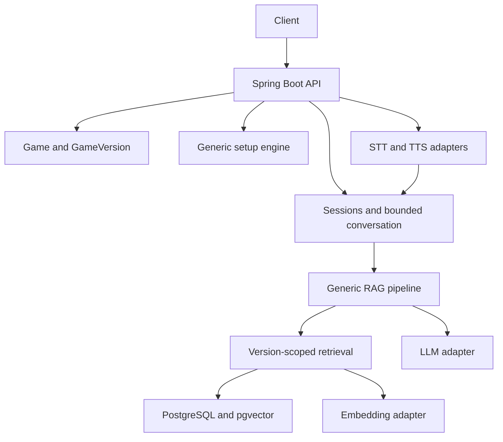

# Board Game Master

AI-powered board game assistant for board game cafés.

The platform is designed to support multiple board games. Catan is used as the initial reference implementation and test dataset.

## Current state
**Milestone 0 — Project Bootstrap is complete and validated.**
The Spring Boot application, Gradle wrapper, PostgreSQL/pgvector Compose service,
Flyway initialization, health, OpenAPI, and API error foundation are present.
Game metadata, rules, RAG, sessions, guided setup, and voice remain planned.
Milestone 1 has not started. See development status for actual check results.

- [Master specification](PROJECT_SPEC.md)
- [Agent instructions](AGENTS.md)
- [Development status](docs/DEVELOPMENT_STATUS.md)
- [Bootstrap architecture and profiles](docs/ARCHITECTURE.md)

## Problem and planned behavior
Customers need help learning games and resolving rules. The planned platform provides grounded answers with citations, contextual conversations, structured learning, deterministic guided setup, and push-to-talk voice.

Customers select a Game, player count, and mode. The backend resolves its default GameVersion and pins that ruleset to the session.

## Planned architecture


Ingestion: permitted source → extraction/cleanup → semantic chunks → embeddings → version-scoped storage.
Question answering: resolve ruleset → query embedding → filtered retrieval/ranking → evidence prompt → grounded answer and citations.

## Planned stack
Java 21+, Spring Boot Web/Data JPA/Validation, PostgreSQL + pgvector, Flyway, Docker Compose, Gradle, OpenAPI, JUnit 5, Mockito, and Testcontainers. Provider abstractions cover LLM, embeddings, STT, and TTS.

## Local setup
Install a JDK 21 and set `JAVA_HOME` to it. A Java 21 Gradle toolchain is required;
the wrapper pins Gradle 8.14.4 and verifies its distribution SHA-256.
Install Docker Desktop with a working Linux container engine (on Windows, configure WSL 2).
The first build and container startup require internet access for dependencies and images.

Run from this repository's root in PowerShell:

```powershell
Copy-Item .env.example .env
# Edit .env and set a nonempty POSTGRES_PASSWORD before continuing.
docker compose up -d --wait
.\gradlew.bat bootRun
```

On macOS/Linux, use `cp .env.example .env` and `sh ./gradlew bootRun`.
The default `local` profile reads `.env` automatically; no shell import is needed.
Use simple unquoted `NAME=value` entries (Java properties syntax), with no `export` or
variable interpolation in `.env`. Existing environment variables override file values.
The database binds only to `127.0.0.1`; its named volume persists across restarts.
Use `docker compose stop` to stop it while retaining data. Changing credentials in
`.env` does not change credentials in an already initialized PostgreSQL volume.

Active configuration:

| Variable | Default / purpose |
| --- | --- |
| `POSTGRES_DB` | `board_game_master`; database created on first container startup |
| `POSTGRES_USER` | `board_game_master`; local database owner |
| `POSTGRES_PASSWORD` | Required local secret; also the application's default DB password |
| `POSTGRES_PORT` | `5432`; localhost port used by Compose and the local app |
| `SERVER_PORT` | `8080`; application HTTP port |
| `DB_URL`, `DB_USERNAME`, `DB_PASSWORD` | Optional local overrides; all three required for `prod` |
| `SPRING_PROFILES_ACTIVE` | Default is `local`; set `prod` for external DB configuration |

The LLM/embedding/speech/RAG names retained in `.env.example` are reserved for future
milestones and are not bound or used. No provider keys are needed for bootstrap.
The `prod` profile does not read `.env` and disables API documentation by default.
Flyway creates the vector extension; the database migration role needs suitable privileges.

## Running database, application, and tests
With the database running, `bootRun` applies Flyway migrations before Hibernate schema
validation. V1 installs pgvector; no game tables or seed data exist yet.

```powershell
.\gradlew.bat test             # Fast MVC/error tests, no Docker needed
.\gradlew.bat integrationTest  # Isolated pgvector PostgreSQL via Testcontainers; Docker required
.\gradlew.bat check bootJar    # Both suites and executable JAR; fails if Docker is unavailable
```

The integration suite runs a real HTTP server on a random port and verifies migration
history, vector operations, repeat migration, health, Swagger, OpenAPI, and missing-resource
errors. It never silently skips missing Docker. No tests call paid AI services.
HTML reports appear under `build/reports/tests/test` and `build/reports/tests/integrationTest`.

Manual demonstration after starting the application:

```powershell
Invoke-RestMethod http://localhost:8080/actuator/health
Invoke-RestMethod http://localhost:8080/v3/api-docs
# Open http://localhost:8080/swagger-ui/index.html in a browser.
```

Health should return `{"status":"UP"}`. OpenAPI currently has no game operations.
Requests to `/api/v1/games` should return HTTP 404 with the shared error format.
Database migrations, application startup, health, and API documentation were verified
with Docker on 2026-10-07; see development status for results. Temporary validation
services have been stopped, so follow the setup commands to start your own local instance.

## Planned API examples
These are design examples, not implemented endpoints:
```http
POST /api/v1/sessions
Content-Type: application/json

{"gameId":"<game-id>","playerCount":4,"mode":"QUICK_START"}
```
```http
POST /api/v1/sessions/<session-id>/messages
Content-Type: application/json

{"message":"What happens if I roll a seven?"}
```

## Roadmap
1. Basic rule Q&A — Milestones 1–4, after bootstrap.
2. Production-quality RAG — Milestone 5.
3. Sessions, conversation, and modes — Milestone 6.
4. Guided setup — Milestone 7.
5. Voice — Milestone 8.

## Adding a game
Register Game and GameVersion, import permitted rules, generate embeddings, configure setup and learning content, add retrieval evaluation cases, and activate the supported version. Shared engines should require no redesign.

## Deferred work
Robot hardware, computer vision, café inventory, recommendations, board-state validation, analytics, and always-listening voice are outside Phases 1–5. Do not redistribute commercial rulebooks without permission.
