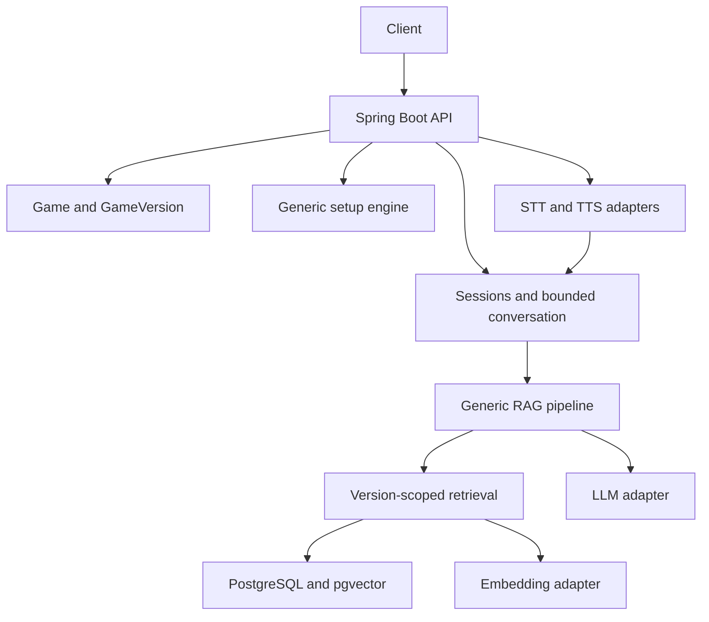

# Board Game Master

AI-powered board game assistant for board game cafés.

The platform is designed to support multiple board games. Catan is used as the initial reference implementation and test dataset.

## Current state
**Milestones 0 and 1 are complete and validated.**
The application supports generic Game and GameVersion metadata, registration/read APIs,
default-version selection, and player-count validation. Catan has one seeded reference
version (5th Edition / English). No rule documents or rules assistance exist yet.
Milestone 2 remains unstarted; ingestion, RAG, sessions, setup, and voice remain planned.

- [Master specification](PROJECT_SPEC.md)
- [Agent instructions](AGENTS.md)
- [Development status](docs/DEVELOPMENT_STATUS.md)
- [Architecture and profiles](docs/ARCHITECTURE.md)

## Problem and planned behavior
Customers need help learning games and resolving rules. The planned platform provides grounded answers with citations, contextual conversations, structured learning, deterministic guided setup, and push-to-talk voice.

Customers select a Game, player count, and mode. The backend resolves its default GameVersion and pins that ruleset to the session.

## Planned architecture


Ingestion: permitted source → extraction/cleanup → semantic chunks → embeddings → version-scoped storage.
Question answering: resolve ruleset → query embedding → filtered retrieval/ranking → evidence prompt → grounded answer and citations.

## Planned stack
Java 21+, Spring Boot Web/Data JPA/Validation, PostgreSQL + pgvector, Flyway, Docker Compose, Gradle, OpenAPI, JUnit 5, Mockito, and Testcontainers. Provider abstractions cover LLM, embeddings, STT, and TTS.

## Local setup
Install a JDK 21 and set `JAVA_HOME` to it. A Java 21 Gradle toolchain is required;
the wrapper pins Gradle 8.14.4 and verifies its distribution SHA-256.
Install Docker Desktop with a working Linux container engine (on Windows, configure WSL 2).
The first build and container startup require internet access for dependencies and images.

Run from this repository's root in PowerShell:

```powershell
if (-not (Test-Path .env)) { Copy-Item .env.example .env }
# Edit .env and set a nonempty POSTGRES_PASSWORD before continuing.
docker compose up -d --wait
.\gradlew.bat bootRun
```

On macOS/Linux, create `.env` from `.env.example` only if it does not already exist,
then use `sh ./gradlew bootRun`.
The default `local` profile reads `.env` automatically; no shell import is needed.
Use simple unquoted `NAME=value` entries (Java properties syntax), with no `export` or
variable interpolation in `.env`. Existing environment variables override file values.
The database binds only to `127.0.0.1`; its named volume persists across restarts.
Use `docker compose stop` to stop it while retaining data. Changing credentials in
`.env` does not change credentials in an already initialized PostgreSQL volume.

Active configuration:

| Variable | Default / purpose |
| --- | --- |
| `POSTGRES_DB` | `board_game_master`; database created on first container startup |
| `POSTGRES_USER` | `board_game_master`; local database owner |
| `POSTGRES_PASSWORD` | Required local secret; also the application's default DB password |
| `POSTGRES_PORT` | `5432`; localhost port used by Compose and the local app |
| `SERVER_PORT` | `8080`; application HTTP port |
| `DB_URL`, `DB_USERNAME`, `DB_PASSWORD` | Optional local overrides; all three required for `prod` |
| `SPRING_PROFILES_ACTIVE` | Default is `local`; set `prod` for external DB configuration |

The LLM/embedding/speech/RAG names retained in `.env.example` are reserved for future
milestones and are not bound or used. No provider keys are needed for bootstrap.
The `prod` profile does not read `.env` and disables API documentation by default.
Flyway creates the vector extension; the database migration role needs suitable privileges.

## Running database, application, and tests
With the database running, `bootRun` applies Flyway migrations before Hibernate schema
validation. V1 installs pgvector; V2 creates the catalog tables and constraints;
V3 adds Catan reference metadata. Restart an already-running Milestone 0 application
to pick up the new code and migrations. Existing database volumes should be retained.

```powershell
.\gradlew.bat test             # Domain validation and MVC/error tests; no Docker needed
.\gradlew.bat integrationTest  # Isolated pgvector PostgreSQL via Testcontainers; Docker required
.\gradlew.bat check bootJar    # Both suites and executable JAR; fails if Docker is unavailable
```

The integration suite runs real HTTP servers and isolated PostgreSQL/pgvector containers.
It verifies migrations (including upgrading a V1 database while preserving existing data),
catalog registration/read APIs, ownership, duplicates, inactive/missing defaults, player limits,
atomic and concurrent default changes, database constraints, health, Swagger, and OpenAPI.
It never silently skips missing Docker and does not use your local Compose database or `.env`.
No tests call paid AI services. Current total: 27 unit tests and 13 integration tests.
HTML reports appear under `build/reports/tests/test` and `build/reports/tests/integrationTest`.

Manual demonstration after starting the application:

```powershell
Invoke-RestMethod http://localhost:8080/actuator/health
Invoke-RestMethod http://localhost:8080/v3/api-docs
# Open http://localhost:8080/swagger-ui/index.html in a browser.
```

Health should contain `"status":"UP"`. Swagger now documents the game catalog operations.
The test suite passed with Docker on 2026-10-07; see development status for actual results.

## Implemented catalog API

| Method | Path | Behavior |
| --- | --- | --- |
| GET | `/api/v1/games?page=0&size=20` | Stable page DTO (`items`, `page`, `size`, `totalElements`, `totalPages`), sorted by slug; size 1–100 |
| POST | `/api/v1/games` | Register metadata; 201 and Location header |
| GET | `/api/v1/games/{gameId}` | Read metadata |
| POST | `/api/v1/games/{gameId}/versions` | Register version; 201 and Location header |
| GET | `/api/v1/games/{gameId}/versions` | Read this game's versions |
| GET | `/api/v1/games/{gameId}/versions/{versionId}` | Read a version with ownership validation |
| GET | `/api/v1/games/{gameId}/default-version?playerCount=4` | Resolve the active default; player count is optional |
| PUT | `/api/v1/games/{gameId}/default-version` | Select an active, owned version using `{"gameVersionId":"..."}` |

Metadata reads include inactive games/versions for configuration visibility. Default resolution
requires an active game, an active default, and a valid player count when supplied.
Games can be registered before their versions; missing defaults return 409 rather than picking
an arbitrary version. Registering with `defaultVersion: true` replaces the previous default
atomically. Repeating PUT with the same version is idempotent. Inactive versions cannot be defaults.
Version identity is edition + versionLabel + language within a game; edition/label comparisons
are case-insensitive and language tags are stored in lowercase. Supported tag syntax includes
`en`, `id`, and `en-US`; it is a constrained syntax, not full BCP 47 registry validation.
The catalog supplies registration/read and default selection; general edits, deletion,
and activation/deactivation APIs are not implemented in this milestone.

After restarting the application, demonstrate the seeded data in PowerShell:

```powershell
Invoke-RestMethod 'http://localhost:8080/api/v1/games'
$catanId = '00000000-0000-0000-0000-000000000001'
Invoke-RestMethod "http://localhost:8080/api/v1/games/$catanId/versions"
Invoke-RestMethod "http://localhost:8080/api/v1/games/$catanId/default-version?playerCount=4"
# playerCount=2 returns HTTP 400 with code INVALID_PLAYER_COUNT.
```

Register another game and a default version:

```powershell
$gameBody = @{
    slug = "demo-$([guid]::NewGuid().ToString('N'))"
    name = 'Demo Game'
    minPlayers = 2
    maxPlayers = 4
    estimatedDurationMinutes = 30
    active = $true
} | ConvertTo-Json
$game = Invoke-RestMethod -Method Post -Uri 'http://localhost:8080/api/v1/games' `
    -ContentType 'application/json' -Body $gameBody
$versionBody = @{
    edition = 'First Edition'
    versionLabel = 'base-game'
    language = 'en'
    active = $true
    defaultVersion = $true
} | ConvertTo-Json
Invoke-RestMethod -Method Post -Uri "http://localhost:8080/api/v1/games/$($game.id)/versions" `
    -ContentType 'application/json' -Body $versionBody
Invoke-RestMethod "http://localhost:8080/api/v1/games/$($game.id)/default-version?playerCount=2"
```

Errors retain the shared `code`, `message`, `timestamp`, and `path` fields. Invalid bodies,
player counts, and pagination return 400; unknown games or versions belonging to another
game return 404; duplicates and unavailable default configurations return 409.
Catan's 90-minute duration is a demo estimate. The selected edition is a reference configuration,
not a claim to be the latest edition or to have ingested its rules. Player counts follow
[CATAN's base-game metadata](https://www.catan.com/catan).

## Planned API examples
These are design examples, not implemented endpoints:
```http
POST /api/v1/sessions
Content-Type: application/json

{"gameId":"<game-id>","playerCount":4,"mode":"QUICK_START"}
```
```http
POST /api/v1/sessions/<session-id>/messages
Content-Type: application/json

{"message":"What happens if I roll a seven?"}
```

## Roadmap
1. Basic rule Q&A — Milestones 1–4, after bootstrap.
2. Production-quality RAG — Milestone 5.
3. Sessions, conversation, and modes — Milestone 6.
4. Guided setup — Milestone 7.
5. Voice — Milestone 8.

## Adding a game
Register Game and GameVersion, import permitted rules, generate embeddings, configure setup and learning content, add retrieval evaluation cases, and activate the supported version. Shared engines should require no redesign.

## Deferred work
Robot hardware, computer vision, café inventory, recommendations, board-state validation, analytics, and always-listening voice are outside Phases 1–5. Do not redistribute commercial rulebooks without permission.
