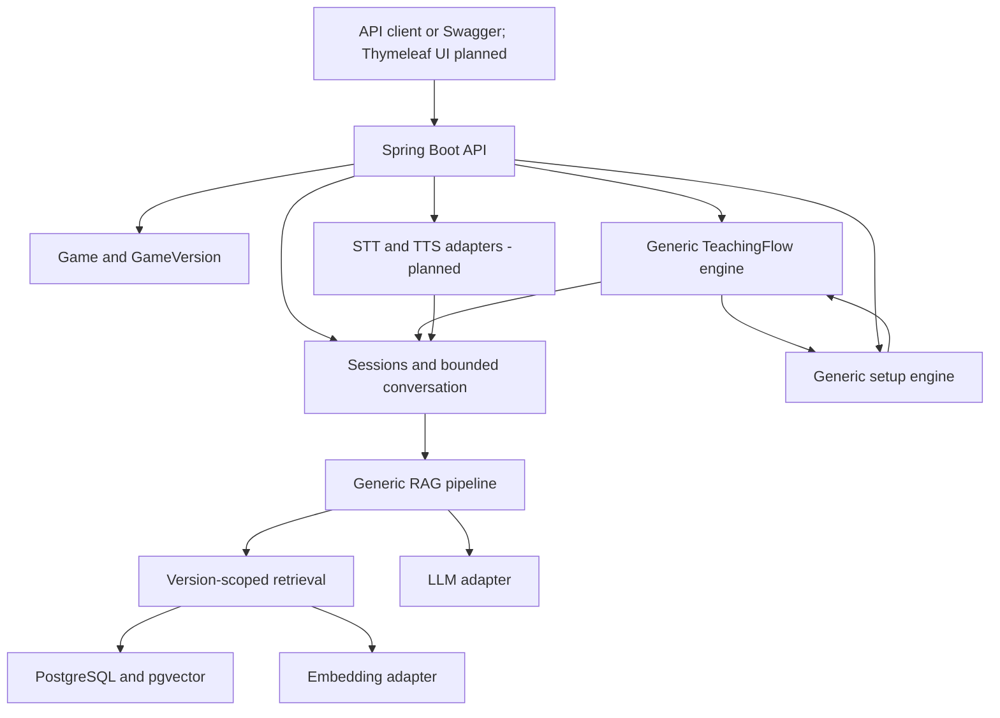

# Board Game Master

Board Game Master is an AI-powered assistant for board game cafés. Its goal is to teach customers how to play a selected game, guide physical setup, and stay available during gameplay for rule questions.

The platform is designed to support multiple board games. Catan is used as the initial reference implementation and test dataset.

## Current state

**Milestones 0–7 are implemented and validated with provider doubles.**
A limited user-run live OpenAI Lantern Trail walkthrough passed on 2026-10-08; broader live
quality evaluation remains deferred. See [the recorded evidence and limitations](docs/DEVELOPMENT_STATUS.md#user-run-live-openai-walkthrough--2026-10-08).
The application supports generic Game and GameVersion metadata, registration/read APIs,
default-version selection, and player-count validation. Catan has one seeded reference
version (5th Edition / English). Permitted UTF-8 text/Markdown documents can now be imported
for a specific version and read as ordered, traceable chunks. Explicit embedding indexing and
version-scoped vector retrieval are implemented with opt-in provider configuration.
Stateless rule questions resolve the game's active default version; session questions use their
pinned version. Both return cited answers or a fixed insufficient-evidence fallback. Retrieval now adds metadata filters, thresholds, duplicate
suppression, a reranking boundary and diagnostics. Milestone 6 adds persistent sessions, version-bound
TeachingFlow, progressive lessons and bounded conversation context. Milestone 7 adds persisted
guided setup with teaching interruption/resume. Voice and browser UI remain planned for Milestone 8.

- [Master specification](PROJECT_SPEC.md)
- [Agent instructions](AGENTS.md)
- [Development status](docs/DEVELOPMENT_STATUS.md)
- [Architecture and profiles](docs/ARCHITECTURE.md)

## Product experience

The teaching → guided setup → resumed teaching → playing journey is implemented through the
backend APIs and Swagger. The sections below describe those capabilities and mark future work
explicitly. Voice and the customer-facing browser UI belong to Milestone 8 and remain unstarted.

## Customer Experience

The intended customer journey is:

1. Select a board game.
2. Select the number of players.
3. Choose how detailed the explanation should be.
4. Start a Game Master session.
5. Learn the game objective.
6. Learn the important components.
7. Follow guided physical setup.
8. Learn the core rules.
9. Learn how turns work.
10. Ask clarification questions at any point.
11. Begin playing.
12. Ask the Game Master rule questions whenever needed.

The product is designed to feel like:

> A Game Master that teaches you the game and then stays with you while you play.

It is not intended to function primarily as an open-ended chatbot.

## Teaching Experience

Teaching is progressive rather than delivered as one large explanation.

The backend tracks TeachingFlow state so customers can:

- continue
- go back
- repeat an explanation
- ask a clarification question
- resume learning afterward

Questions use Retrieval-Augmented Generation (RAG) against imported, permitted rule documents.
Live answering requires indexed documents and explicitly enabled embedding/LLM providers.
Teaching and setup instructions alone are not indexed rule evidence.

## Guided Setup

Setup is integrated into the teaching experience.

The backend tracks setup state independently from the LLM through version-bound authored steps.

Customers follow authored steps and confirm completion before returning to the saved teaching
lesson. The application records their confirmation; it cannot inspect the physical board.
Legacy teaching flows without a setup trigger retain their earlier behavior.

## During the Game

Once teaching finishes, the same GameSession transitions into gameplay mode.

The Game Master remains available for questions such as:

- "What can I do on my turn?"
- "Can I trade now?"
- "What happens when I roll a seven?"
- "How many cards do I discard?"

Answers are grounded in the configured GameVersion's rule documents and provide source references when available.

## Architecture

The project uses a modular Spring Boot backend.

Core concepts include:

- Game
- GameVersion
- RuleDocument
- RuleChunk
- GameSession
- ConversationMessage
- TeachingFlow
- TeachingSection
- SetupFlow
- SetupStep

AI integrations are kept behind provider abstractions.

The project uses PostgreSQL with pgvector installed. Rule-document storage and semantic
retrieval, cited answer generation, sessions, teaching and guided setup are implemented; voice and browser UI remain planned.

## RAG

Rule questions follow a Retrieval-Augmented Generation pipeline:

Customer Question

→

Load GameSession

→

Resolve GameVersion

→

Create Query Embedding

→

Retrieve Relevant RuleChunks

→

Rank Evidence

→

Provide Evidence to LLM

→

Generate Grounded Answer

→

Return Answer + Sources

Session questions load the pinned GameVersion and bounded context; the stateless question
endpoint resolves the current active default without loading a session. Empty or weak evidence
can return the fixed LOW-confidence fallback without generation.

The system should prefer saying it cannot confidently verify a rule rather than inventing one.

## Teaching depth and session stages

Choose QUICK, STANDARD or DETAILED; STANDARD is the default café experience. These are
explanation depths within the same Game Master session. The normal journey is:

Select Game → Player Count → Teaching Depth → Create Session → Teaching → Guided Setup
→ Continue Teaching → Ready to Play → In-Game Rule Q&A → Completed.

Customers normally select Game only. The backend resolves and pins an active default
GameVersion. Application-managed TEACHING / SETUP / PLAYING / COMPLETED stages and persisted
lesson/setup positions control progress; the LLM does not decide the next step. TeachingFlow
chooses what comes next; RAG supplies verified rule evidence. Clarifications preserve both
lesson and setup progress. The planned browser UI will provide Review Rules without resetting the session.

## Architecture and planned interfaces



Ingestion: permitted UTF-8 text/Markdown → cleanup → structural chunks → explicit embedding indexing → version-scoped storage.
Question answering: resolve ruleset → query embedding → filtered retrieval/ranking → evidence prompt → grounded answer and citations.

## Stack

Implemented: Java 21, Spring Boot Web/Data JPA/Validation, PostgreSQL + pgvector, Flyway,
Docker Compose, the Gradle wrapper, OpenAPI/Swagger, JUnit 5, Mockito and Testcontainers.
Embedding and LLM integrations use provider-neutral interfaces.

Planned for Milestone 8: STT/TTS interfaces and adapters, plus a thin Thymeleaf UI with HTML/CSS
and minimal JavaScript. Future UI controllers will reuse backend services; templates and
JavaScript will not own workflow, RAG or game logic.

## Local setup

Install a JDK 21 and set `JAVA_HOME` to it. A Java 21 Gradle toolchain is required;
the wrapper pins Gradle 8.14.4 and verifies its distribution SHA-256.
Install Docker Desktop with a working Linux container engine (on Windows, configure WSL 2).
The first build and container startup require internet access for dependencies and images.

Run from this repository's root in PowerShell:

```powershell
if (-not (Test-Path .env)) { Copy-Item .env.example .env }

# Edit .env and set a nonempty POSTGRES_PASSWORD before continuing.

docker compose up -d --wait
.\gradlew.bat bootRun
```

On macOS/Linux, create `.env` from `.env.example` only if it does not already exist,
then use `sh ./gradlew bootRun`.
The default `local` profile reads `.env` automatically; no shell import is needed.
Use simple unquoted `NAME=value` entries (Java properties syntax), with no `export` or
variable interpolation in `.env`. Existing environment variables override file values.
The database binds only to `127.0.0.1`; its named volume persists across restarts.
Use `docker compose stop` to stop it while retaining data. Changing credentials in
`.env` does not change credentials in an already initialized PostgreSQL volume.

Active configuration:

| Variable | Default / purpose |
| --- | --- |
| `POSTGRES_DB` | `board_game_master`; database created on first container startup |
| `POSTGRES_USER` | `board_game_master`; local database owner |
| `POSTGRES_PASSWORD` | Required local secret; also the application's default DB password |
| `POSTGRES_PORT` | `5432`; localhost port used by Compose and the local app |
| `SERVER_PORT` | `8080`; application HTTP port |
| `DB_URL`, `DB_USERNAME`, `DB_PASSWORD` | Optional local overrides; all three required for `prod` |
| `SPRING_PROFILES_ACTIVE` | Default is `local`; set `prod` for external DB configuration |
| `RULE_CHUNK_SIZE` | `1200`; maximum chunk length, 64–16000 UTF-16 characters |
| `RULE_CHUNK_OVERLAP` | `200`; whole trailing paragraph/sentence overlap budget, 0 to size minus 1 |
| `RULE_MAX_BYTES` | `1048576` (1 MiB); import byte limit, at most 10 MiB |
| `RULE_MAX_CHUNKS` | `10000`; import chunk limit, 1–100000 |
| `EMBEDDING_PROVIDER` | `disabled`; set `openai` to enable provider requests |
| `EMBEDDING_MODEL` | `text-embedding-3-small`; selected embedding model |
| `EMBEDDING_API_KEY` | Required only when `openai` is enabled; keep private |
| `EMBEDDING_DIMENSIONS` | `1536`; vector dimensions, 1–2000 |
| `EMBEDDING_TIMEOUT` | `30s`; connect/request timeout, greater than zero and at most 120s |
| `EMBEDDING_MAX_INPUT_CHARACTERS` | `4000`; maximum chunk/query UTF-16 length, 1–16000 |
| `EMBEDDING_MAX_DOCUMENT_CHUNKS` | `1000`; synchronous indexing limit, 1–10000 |
| `RAG_TOP_K` | `5`; default retrieved match count, 1–50 |
| `RAG_SIMILARITY_THRESHOLD` | `0.5`; minimum cosine similarity, finite −1 to 1; blank legacy values use the default |
| `RAG_CANDIDATE_LIMIT` | `200`; candidates considered before deduplication/reranking, 50–500 |
| `RAG_DUPLICATE_OVERLAP` | `0.85`; minimum five-word-shingle overlap for contained source ranges, 0.5–1 |
| `LLM_PROVIDER` | `disabled`; set `openai` to enable answer generation |
| `LLM_MODEL` | `gpt-4.1-mini`; must support Responses structured outputs and temperature |
| `LLM_API_KEY` | Required when the LLM is enabled; private and independent of the embedding key setting |
| `LLM_TIMEOUT` | `30s`; connect/request timeout, greater than zero and at most 120s |
| `LLM_MAX_OUTPUT_TOKENS` | `800`; output budget, 128–4096; incomplete output fails safely |
| `ANSWER_MINIMUM_EVIDENCE_SIMILARITY` | `0.5`; baseline acceptance gate for cited evidence, 0 to below the HIGH gate |
| `ANSWER_HIGH_EVIDENCE_SIMILARITY` | `0.8`; HIGH confidence gate, above the minimum and at most 1 |
| `ANSWER_MAX_CONTEXT_CHARACTERS` | `24000`; serialized question/evidence budget, 1000–160000 UTF-16 characters |
| `ANSWER_MINIMUM_QUOTE_CHARACTERS` | `12`; minimum supporting quote length for HIGH confidence, 1–1000 |
| `SESSION_RECENT_MESSAGE_LIMIT` | `8`; maximum recent messages considered for contextual Q&A, 2–50 |
| `SESSION_CONTEXT_CHARACTERS` | `8000`; whole recent-message content budget, 1000–16000 |

Speech, `AI_*` and `RAG_CHUNK_*` settings remain reserved.
Embedding, retrieval (`RAG_*` except `RAG_CHUNK_*`), LLM, answer and session settings in the table are active. No provider keys are needed for ingestion,
startup or automated tests; the default provider is disabled.
Active ingestion configuration uses `boardgame.rules.*` / `RULE_*`; the older `RAG_CHUNK_*`
proposals remain inactive. Invalid ingestion/embedding/retrieval/LLM/answer/session limits fail startup. Add optional
overrides to your existing `.env`; do not overwrite it with the example file.
The `prod` profile does not read `.env` and disables API documentation by default.
Flyway creates the vector extension; the database migration role needs suitable privileges.

## Running database, application, and tests

With the database running, `bootRun` applies Flyway migrations before Hibernate schema
validation. V1 installs pgvector; V2 creates the catalog tables and constraints;
V3 adds Catan reference metadata; V4 adds version-scoped rule documents and chunks.
Restart an already-running application to pick up the new code and migrations.
V5 adds embedding storage and its ruleset/profile index. Existing database volumes should be
retained. No rule documents or embeddings are seeded automatically; existing imports keep
their stored vectors, and unindexed documents require explicit indexing.
V6 adds sessions, conversation history and version-bound teaching, including original introductory
Catan lessons. V7 adds setup flows/steps, persisted session setup progress and a setup trigger
in a new reference teaching flow. Existing lessons, sessions, history, documents and vectors are retained.

```powershell
.\gradlew.bat test             # Domain validation and MVC/error tests; no Docker needed
.\gradlew.bat integrationTest  # Isolated pgvector PostgreSQL via Testcontainers; Docker required
.\gradlew.bat check bootJar    # Both suites and executable JAR; fails if Docker is unavailable
```

The integration suite runs real HTTP servers and isolated PostgreSQL/pgvector containers.
It verifies migrations (including upgrading a V1 database while preserving existing data),
catalog registration/read APIs, ownership, duplicates, inactive/missing defaults, player limits,
atomic and concurrent default changes, database constraints, health, Swagger, and OpenAPI.
It never silently skips missing Docker and does not use your local Compose database or `.env`.
No tests call paid AI services. Rule ingestion tests also cover cleanup, chunk boundaries,
overlap, UTF-8 validation, source offsets, page metadata, version isolation, atomic rollback,
upload limits, migration preservation and vector retrieval. See development status for current test totals.
HTML reports appear under `build/reports/tests/test` and `build/reports/tests/integrationTest`.

Manual demonstration after starting the application:

```powershell
Invoke-RestMethod http://localhost:8080/actuator/health
Invoke-RestMethod http://localhost:8080/v3/api-docs

# Open http://localhost:8080/swagger-ui/index.html in a browser.

```

Health should contain `"status":"UP"`. Swagger documents catalog, rules, retrieval, questions,
sessions, teaching and guided setup operations. The recorded Milestone 7 `check bootJar` run
passed 279 tests (192 unit, 87 integration) with no failures or skips. This is the existing
implementation validation, not a fresh run for this README review. See development status
for the dated evidence and evaluation limitations.

The existing GitHub Actions workflow runs `check bootJar` on pull requests targeting `main`,
pushes to `main`, and manual dispatch. New tests are discovered automatically; no OpenAI secrets
are required. A push to a milestone branch alone does not trigger this workflow.

## Implemented catalog API

| Method | Path | Behavior |
| --- | --- | --- |
| GET | `/api/v1/games?page=0&size=20` | Stable page DTO (`items`, `page`, `size`, `totalElements`, `totalPages`), sorted by slug; size 1–100 |
| POST | `/api/v1/games` | Register metadata; 201 and Location header |
| GET | `/api/v1/games/{gameId}` | Read metadata |
| POST | `/api/v1/games/{gameId}/versions` | Register version; 201 and Location header |
| GET | `/api/v1/games/{gameId}/versions` | Read this game's versions |
| GET | `/api/v1/games/{gameId}/versions/{versionId}` | Read a version with ownership validation |
| GET | `/api/v1/games/{gameId}/default-version?playerCount=4` | Resolve the active default; player count is optional |
| PUT | `/api/v1/games/{gameId}/default-version` | Select an active, owned version using `{"gameVersionId":"..."}` |

Metadata reads include inactive games/versions for configuration visibility. Default resolution
requires an active game, an active default, and a valid player count when supplied.
Games can be registered before their versions; missing defaults return 409 rather than picking
an arbitrary version. Registering with `defaultVersion: true` replaces the previous default
atomically. Repeating PUT with the same version is idempotent. Inactive versions cannot be defaults.
Version identity is edition + versionLabel + language within a game; edition/label comparisons
are case-insensitive and language tags are stored in lowercase. Supported tag syntax includes
`en`, `id`, and `en-US`; it is a constrained syntax, not full BCP 47 registry validation.
The catalog supplies registration/read and default selection; general edits, deletion,
and activation/deactivation APIs are not implemented in this milestone.

After restarting the application, demonstrate the seeded data in PowerShell:

```powershell
Invoke-RestMethod 'http://localhost:8080/api/v1/games'
$catanId = '00000000-0000-0000-0000-000000000001'
Invoke-RestMethod "http://localhost:8080/api/v1/games/$catanId/versions"
Invoke-RestMethod "http://localhost:8080/api/v1/games/$catanId/default-version?playerCount=4"

# playerCount=2 returns HTTP 400 with code INVALID_PLAYER_COUNT.

```

Register another game and a default version:

```powershell
$gameBody = @{
    slug = "demo-$([guid]::NewGuid().ToString('N'))"
    name = 'Demo Game'
    minPlayers = 2
    maxPlayers = 4
    estimatedDurationMinutes = 30
    active = $true
} | ConvertTo-Json
$game = Invoke-RestMethod -Method Post -Uri 'http://localhost:8080/api/v1/games' `
    -ContentType 'application/json' -Body $gameBody
$versionBody = @{
    edition = 'First Edition'
    versionLabel = 'base-game'
    language = 'en'
    active = $true
    defaultVersion = $true
} | ConvertTo-Json
Invoke-RestMethod -Method Post -Uri "http://localhost:8080/api/v1/games/$($game.id)/versions" `
    -ContentType 'application/json' -Body $versionBody
Invoke-RestMethod "http://localhost:8080/api/v1/games/$($game.id)/default-version?playerCount=2"
```

Errors retain the shared `code`, `message`, `timestamp`, and `path` fields. Invalid bodies,
player counts, and pagination return 400; unknown games or versions belonging to another
game return 404; duplicates and unavailable default configurations return 409.
Catan's 90-minute duration is a demo estimate. The selected edition is a reference configuration,
not a claim to be the latest edition or to have ingested its rules. Player counts follow
[CATAN's base-game metadata](https://www.catan.com/catan).

## Implemented rule-document API

All routes are scoped to `/api/v1/game-versions/{versionId}/documents`.

| Method | Suffix | Behavior |
| --- | --- | --- |
| POST | (none) | Multipart `metadata` JSON and `file`; returns 201, metadata and Location |
| GET | `?page=0&size=20` | Document metadata pages, ordered by import time and ID; size 1–100 |
| GET | `/{documentId}` | Source metadata, import timestamp and effective chunk settings/count |
| GET | `/{documentId}/source` | Cleaned source text for tracing chunk offsets |
| GET | `/{documentId}/chunks?page=0&size=20` | Chunks ordered by zero-based `chunkIndex`; size 1–100 |

Import only sources you own or have permission to use. Upload local `.txt` or `.md` files
encoded as UTF-8. Metadata requires `name`, `sourceType` (`RULEBOOK`, `FAQ`, `ERRATA`,
`EXPANSION`), document `version`, `language`, and `sourceReference` (a descriptive source
label, local reference, or URL retained as data). Language must match the selected GameVersion.
Inactive versions can receive documents for catalog preparation. No server paths or URLs
are fetched. Files are decoded strictly; empty/binary/malformed input fails before storage.

Cleanup removes a leading BOM, normalizes line endings to LF, removes trailing spaces,
and collapses excess blank lines. Chunking follows ATX Markdown headings (`#` through `######`)
and paragraphs, then sentence/word boundaries for oversized paragraphs. Long tokens use a
Unicode-safe hard split as a fallback. Fenced code stays text. This is structural chunking,
not an AI-based semantic parser or a full Markdown renderer; Setext headings, tables and lists
receive paragraph treatment. The limit measures UTF-16 characters, not embedding tokens.

Overlap reuses whole trailing paragraphs/sentences when they fit the configured budget;
it may be smaller than requested or zero and never crosses a section or page boundary.
Optional standalone `<!-- page: N -->` markers identify positive page numbers; otherwise
`pageNumber` is null. Page markers stay in the cleaned source but are excluded from chunks.
Sections retain the nearest heading. Chunks carry document/version IDs and exact
`startOffset`/`endOffset` into cleaned source (zero-based UTF-16, exclusive end). The GameVersion
links to the owning game and edition. Imports store all chunks in one transaction.

For a safe manual demo, first register a **Demo Game** and English version using the catalog
example above, then resolve that game's default version. Do not attach fictional demo rules
to the Catan reference version. From the repository root in PowerShell:

```powershell

# $game is the Demo Game created in the catalog example above.

$version = Invoke-RestMethod "http://localhost:8080/api/v1/games/$($game.id)/default-version"
$base = "http://localhost:8080/api/v1/game-versions/$($version.id)/documents"

# curl.exe is used explicitly to avoid the Windows PowerShell curl alias.

$importJson = curl.exe --fail-with-body --silent --show-error -X POST $base `
    -F 'metadata=@examples/original-demo-metadata.json;type=application/json' `
    -F 'file=@examples/original-demo-rules.md;type=text/markdown'
$document = $importJson | ConvertFrom-Json
Invoke-RestMethod "$base/$($document.id)"
(Invoke-RestMethod "$base/$($document.id)/chunks?size=100").items | Format-List
Invoke-RestMethod "$base/$($document.id)/source"
```

The bundled Lantern Trail document is original fictional text dedicated under CC0 1.0.
It is not a commercial rulebook. For your own permitted source, use your file path after `@`
and prepare matching JSON metadata. Keep commercial/private inputs outside Git (for example
the ignored `local-rules/` folder). Swagger also accepts the multipart upload.

Errors use the shared DTO: invalid input 400, unknown/wrong-version documents 404,
unsupported extension 415, byte/chunk limits 413, database conflicts 409. A separate servlet
limit rejects files/requests over 10 MiB; oversized requests may return `PAYLOAD_TOO_LARGE`
before application-level `DOCUMENT_TOO_LARGE` validation. Upload MIME labels are not trusted;
extension and decoded contents determine acceptance.

PDF extraction, URL import, document editing/deletion, deduplication and asynchronous ingestion
are not implemented. Repeating an import creates a new document.
There is no authentication yet; this remains a local-development API. Restart the app to
apply the pending migrations before using these endpoints. The implementation checks did not migrate your local DB.

## Implemented embeddings and retrieval API

| Method | Path | Behavior |
| --- | --- | --- |
| GET | `/api/v1/game-versions/{versionId}/documents/{documentId}/embeddings` | Counts for the active vector profile; no provider call |
| POST | `/api/v1/game-versions/{versionId}/documents/{documentId}/embeddings` | Generate/store missing vectors for this document; synchronous and idempotent for the profile |
| POST | `/api/v1/game-versions/{versionId}/rules/search` | Retrieve ranked source chunks; JSON `{"query":"...","topK":5}`; topK optional |

These endpoints retrieve evidence only. They do not produce a generated answer, confidence label,
teaching flow or session. Search returns source metadata and `cosineSimilarity` (−1 to 1), which
measures vector alignment rather than confidence or factual correctness. Retrieval applies the
configured similarity threshold, metadata filtering and duplicate suppression before final top-K.
Unknown/wrong-version sources return 404, invalid input 400, an indexing size limit 413 and
storage conflicts 409. Disabled/unavailable/rate-limited providers return safe 503 errors,
provider timeouts 504 and invalid responses 502. Rule text and raw provider errors are not logged.

Indexing is separate from import. Restart the app to apply V5, then explicitly index each existing
document you want searchable. The provider is **disabled by default**. To opt in, add or update
these entries in your existing private `.env` without replacing its database credentials:

```dotenv
EMBEDDING_PROVIDER=openai
EMBEDDING_MODEL=text-embedding-3-small
EMBEDDING_API_KEY=your-private-api-key
EMBEDDING_DIMENSIONS=1536
```

Restart after changing configuration. Blank legacy provider/model/dimensions entries use the
disabled/default settings, so an older `.env` keeps startup working. Enabling OpenAI requires a
nonblank API key. Indexing and nonempty-index search send rule/query text to the configured
provider and may incur charges; no external provider calls were made during implementation checks.

The adapter follows the [official OpenAI embeddings API](https://developers.openai.com/api/reference/resources/embeddings/methods/create),
using float output and explicit dimensions. Select a model supporting the dimensions parameter.
The character limit is a resource bound, not an exact token count; provider token limits still
apply, and oversized chunks may need smaller ingestion settings and a fresh import.

For the demo document created in the previous section, after opting in and restarting:

```powershell
# Reuse $version.id and $document.id from the import demo, or replace with saved UUIDs.
$versionBase = "http://localhost:8080/api/v1/game-versions/$($version.id)"
$indexUrl = "$versionBase/documents/$($document.id)/embeddings"
Invoke-RestMethod $indexUrl
Invoke-RestMethod -Method Post -Uri $indexUrl
Invoke-RestMethod $indexUrl
$search = @{ query = 'What happens when my token reaches the last space?'; topK = 3 } | ConvertTo-Json
(Invoke-RestMethod -Method Post -Uri "$versionBase/rules/search" `
    -ContentType 'application/json' -Body $search).matches | Format-List
```

Expected: indexed counts equal total chunks, and search returns only this selected version's
eligible sources above the similarity threshold, with stable cosine tie ordering by default. An empty index returns an
empty match list without a query embedding call. Repeated indexing reuses existing profile vectors.
Changing provider/model/dimensions selects a different vector space; old vectors remain stored,
but each document must be indexed for the new profile before it contributes search results.
Concurrent indexing may duplicate provider requests, though stored vectors remain unique.
Indexing is atomic per document and defaults to at most 1000 chunks; large/background jobs and
model-vector deletion remain deferred. Prefer indexing permitted sources you are willing to send
to the selected provider.

Storage uses pgvector with a version/profile B-tree filter index and exact search, avoiding ANN
recall loss at current scale. See [pgvector's exact search documentation](https://github.com/pgvector/pgvector/tree/v0.8.2#querying).
Tests use fixed known vectors and local fake HTTP responses, independent of LLMs and API keys.

## Retrieval filters, ranking and evaluation

Version-scoped search and stateless game-question requests accept optional `topK`,
`similarityThreshold` and `filters`. Session message requests accept only `question` and use
configured retrieval defaults; these per-request filter overrides do not apply to them.
Existing bodies containing only `query` or `question` still work, with the new safe retrieval
defaults. Example for `/api/v1/game-versions/{versionId}/rules/search`:

```json
{
  "query": "What happens when my token reaches the last space?",
  "topK": 3,
  "similarityThreshold": 0.5,
  "filters": {
    "language": "en",
    "sourceTypes": ["RULEBOOK", "FAQ", "ERRATA"],
    "documentIds": [],
    "expansionDocumentIds": []
  }
}
```

For questions, replace `query` with `question`; the game still resolves its default version.
Omitted language uses the selected version's language. Language tags are normalized; filtering
does not translate text or switch editions. Source types are RULEBOOK/FAQ/ERRATA/EXPANSION.
Each ID/type set is limited to 50 entries; empty sets mean no additional restriction, except
an empty `expansionDocumentIds` always excludes EXPANSION documents. All filters intersect.

`documentIds` must belong to the selected version; unknown/foreign IDs return 404 before a
provider call. To include expansion rules, explicitly provide owned EXPANSION document IDs in
`expansionDocumentIds`; selecting a base document there returns 400. An EXPANSION source-type
filter alone does not enable expansions. This is an expansion-ready document selection boundary,
not a session, expansion catalog or automatic expansion activation feature.

Metadata constraints run in parameterized SQL before the bounded cosine candidate selection.
If no eligible indexed document exists, no query-provider call occurs. The active vector profile
and version remain mandatory regardless of filters. The candidate pool is thresholded, then
deduplicated, passed through `RuleReranker` and finally limited to top-K. The default reranker
preserves cosine order; no cross-encoder or paid reranking model is installed. A replacement
must return a permutation of the original candidates without altered scores/provenance;
invalid output or failure returns safe 502 `RERANKING_FAILED`.

Duplicate suppression retains the best-ranked occurrence of NFC/whitespace-normalized identical
text within the same version/language/source type/document version. It also suppresses substantial
contained passages in the same document when the retained passage contains the shorter candidate's source range and their
five-word shingle overlap reaches the configured limit. Short variants, negation/number changes,
different source types, languages and document versions remain distinct. A longer passage is never
dropped in favor of a shorter one. No imports are deleted.

Search responses add `diagnostics`: effective filters/threshold/candidate limit, candidate count,
below-threshold count, duplicates removed, returned count, elapsed milliseconds and
`candidateLimitReached`. Logs record counts/IDs/timing without question/document text.
The bounded pool may return fewer than top-K results if many candidates are weak/duplicate;
reaching its limit signals that later eligible evidence may have been omitted. This is exact
cosine selection within a bounded pool, not a guarantee of exhaustive deduplicated recall.

`src/test/resources/evaluation/catan-rule-questions.json` contains original narrow test paraphrases,
expected topics/sections, six supported questions and two unsupported questions. The integration
evaluation imports these into isolated PostgreSQL, adds duplicate imports and foreign rulesets,
and checks retrieval independently of generation. No commercial rulebook or paid calls are used.
Run with Docker Desktop available:

```powershell
.\gradlew.bat integrationTest --tests '*RetrievalEvaluationIntegrationTest' --rerun-tasks
```

The test writes `build/reports/retrieval-evaluation.json` with per-question diagnostics, Recall@3,
MRR@3 and unsupported-question abstentions. See development status for the actual recorded run.
Hand-assigned vectors make this a deterministic pipeline regression benchmark; it does not
measure OpenAI embedding relevance, hallucination rate or production confidence calibration.
The limited user-run OpenAI walkthrough is recorded in DEVELOPMENT_STATUS.md; broader live quality evaluation remains deferred.

## Implemented rule question API

`POST /api/v1/games/{gameId}/questions` accepts:

```json
{
  "question": "What happens when my token reaches the last space?"
}
```

The backend resolves the game's active default GameVersion, then reuses version/profile-scoped
retrieval. Clients do not select an edition. This stateless endpoint resolves the current default;
use the session endpoints below for a pinned ruleset and conversation history. Questions must be nonblank and at most 4000
characters, also within the configured embedding input limit.

For live testing, first import and index a permitted document as described above. Add or update
these entries in your existing private `.env`, preserving database and embedding settings:

```dotenv
LLM_PROVIDER=openai
LLM_MODEL=gpt-4.1-mini
LLM_API_KEY=your-private-api-key
```

Both embedding and LLM providers are opt-in. Blank legacy LLM settings remain disabled/default.
Restart after configuration changes. No extra database migration is needed for Milestone 4;
V6 adds sessions/teaching and V7 adds guided setup. Requests with indexed rules may incur a query-embedding charge and an
LLM charge. Default tests require neither keys nor paid calls. A private key may be used in both
key settings if it has appropriate permissions, but each setting must be configured explicitly.

Using the demo game's ID from the import walkthrough:

```powershell
$question = @{ question = 'What happens when my token reaches the last space?' } | ConvertTo-Json
Invoke-RestMethod -Method Post -Uri "http://localhost:8080/api/v1/games/$($game.id)/questions" `
    -ContentType 'application/json' -Body $question | ConvertTo-Json -Depth 8
```

You can also execute this endpoint in Swagger. The response contains `gameId`, `gameVersionId`,
`answer`, `confidence` (`HIGH`, `MEDIUM`, `LOW`) and `sources`. Each accepted source contains
stored chunk/document/version IDs, document/type/version/language/reference, section/page,
chunk offsets, an exact supporting quote and cosine similarity. Source metadata is resolved
from storage, never trusted from model-generated names or pages.

The dedicated prompt builder keeps trusted instructions separate from JSON-encoded untrusted
questions/document data, prohibits invented rules and asks the model to decline unsupported or
conflicting evidence. Context preserves complete chunks in retrieval order within its serialized
character budget. Generation uses the [OpenAI Responses structured-output contract](https://developers.openai.com/api/docs/guides/structured-outputs),
temperature 0, a bounded output budget and `store=false`; no tools or provider-side conversation persistence.
Session conversation history is stored locally by the application.
The default [GPT-4.1 mini model](https://developers.openai.com/api/docs/models/gpt-4.1-mini) supports this contract.

Confidence is a baseline evidence heuristic, not a calibrated probability. With no supplied chunk
meeting the minimum gate, generation is skipped. The model must also report sufficient evidence;
every returned citation must identify a supplied chunk, quote its exact content and meet the
minimum gate. Unknown/excluded citations, invented quotes or duplicate citations fail closed.
Accepted answers are HIGH only if every cited chunk meets the HIGH gate, all strong prompt
evidence is cited, and every quote meets `ANSWER_MINIMUM_QUOTE_CHARACTERS`; otherwise MEDIUM.
This conservatively downgrades partial evidence coverage and trivial quotes.
Empty/weak evidence, refusal or failed citation checks return HTTP 200, LOW, no sources and:

> I couldn't verify that confidently from the available rules.

Retrieval now filters weak matches and duplicates before the answer prompt is built. Its threshold
and the separate answer acceptance gates both apply, so lowering the retrieval threshold alone
does not allow weak cited evidence into an answer. Real-model relevance, threshold calibration
and resistance to adversarial prompts remain unverified. Exact
quotes validate provenance but cannot prove that all generated prose is semantically supported.
A narrow live OpenAI walkthrough has passed; broader retrieval/grounding evaluation remains deferred.

Unknown games return 404; inactive games/default versions or missing defaults return 409;
invalid questions return 400. Existing embedding errors retain their codes/statuses. Disabled,
unavailable or rate-limited LLMs return 503, timeouts 504, and malformed/incomplete output 502.
Provider outages remain errors rather than being disguised as low-confidence answers. With
embeddings configured and an empty index, no query-embedding or LLM call is made; if embeddings
are disabled, the existing `EMBEDDING_NOT_CONFIGURED` error still applies.

## Implemented sessions and teaching API

Restart the application to apply V6 and V7. Existing content and sessions are preserved.
The new Catan reference teaching flow has eleven concise sections: QUICK selects eight,
STANDARD ten and DETAILED eleven, including PHYSICAL_SETUP at every depth. It is an introductory
overview, not a complete commercial rulebook. Six authored setup steps record the user's confirmation;
the application cannot inspect the physical board. If a custom Catan teaching flow was already
published, V7 preserves it as the current flow instead of replacing it.
Teaching/navigation require no provider keys, indexing or paid calls.

Create a session in Swagger or PowerShell:

```powershell
$base = 'http://localhost:8080/api/v1'
$body = @{ gameId = '00000000-0000-0000-0000-000000000001'; playerCount = 4 } | ConvertTo-Json
$lesson = Invoke-RestMethod -Method Post -Uri "$base/sessions" -ContentType 'application/json' -Body $body
$sessionId = $lesson.session.id
$lesson | ConvertTo-Json -Depth 10
```

Creation returns HTTP 201 and a Location header. Optional `teachingDepth` is QUICK, STANDARD
(default), or DETAILED. The backend validates player count, resolves the active default ruleset
once and pins its GameVersion, current TeachingFlow and configured SetupFlow. Changing either the catalog default
or publishing a replacement flow does not change existing sessions. A version needs a configured
flow before a session can be created; missing configuration returns 409.

`GET /sessions/{id}` returns persisted session state, current lesson, displayed explanation,
lesson number/total, completed section keys, revision and readiness notice. Navigation accepts
the most recently returned revision to prevent accidental double advancement:

```powershell
$body = @{ action = 'CONTINUE'; expectedRevision = $lesson.session.revision } | ConvertTo-Json
$lesson = Invoke-RestMethod -Method Post -Uri "$base/sessions/$sessionId/teaching/actions" `
    -ContentType 'application/json' -Body $body
$lesson | ConvertTo-Json -Depth 10
```

Actions are CONTINUE, PREVIOUS, REPEAT and EXPLAIN_AGAIN. CONTINUE normally completes the current
section and advances. At a section with setupTrigger=true, it starts unfinished setup instead,
saving this lesson as the return position without completing it. PREVIOUS preserves completed progress, stopping at
the first lesson. REPEAT returns the saved explanation. EXPLAIN_AGAIN presents the same authored
content with its examples/tips, without an LLM rewrite or progress change. Every action updates
the revision; stale requests return `SESSION_CONFLICT` (409). Reload with GET before retrying.
Once required triggered setup is confirmed, the final teaching CONTINUE enters PLAYING in the
same session and displays a ready-to-play notice. A final lesson that triggers unfinished setup
enters SETUP first; completing setup returns to TEACHING before that final Continue.
Lesson navigation is restricted to TEACHING. Setup completion returns to the saved lesson in
TEACHING; a further CONTINUE advances normally. A completed setup trigger does not run twice.

Questions work during teaching, setup and playing through the existing grounded-answer pipeline:

```powershell
$body = @{ question = 'How do I collect resources?' } | ConvertTo-Json
$reply = Invoke-RestMethod -Method Post -Uri "$base/sessions/$sessionId/messages" `
    -ContentType 'application/json' -Body $body
$reply | ConvertTo-Json -Depth 10
$lesson = Invoke-RestMethod -Uri "$base/sessions/$sessionId"
```

Use `question`, not `message`. Questions preserve the current lesson, completed sections,
setup step, confirmed setup steps and saved teaching return point.
The response contains `sessionId`, new `revision`, `currentSectionKey` and the existing nested
`answer`/confidence/sources contract. Successful answers and LOW fallbacks persist an atomic
USER/ASSISTANT pair, including source citations. Provider failures persist neither message and
leave workflow state unchanged. Live Q&A still requires explicitly configured embedding/LLM
providers and indexed permitted documents for the pinned version. The seeded Catan lessons are
not automatically imported or indexed as rule evidence. With providers disabled, Q&A returns
the existing safe 503 errors; teaching continues to work.

`SessionContextService` loads game, pinned edition/language, player count, depth, stage, current
lesson, active setup step during SETUP and bounded recent messages. Defaults are `SESSION_RECENT_MESSAGE_LIMIT=8` (2–50) and
`SESSION_CONTEXT_CHARACTERS=8000` (1000–16000). They are optional additions to a private `.env`;
omitting them uses defaults. Only whole recent messages within both limits are retained.
The retrieval query preserves the current question, then adds the active setup title (during SETUP),
latest retained user question and lesson title within the available budget. It is capped at
4000 characters and the configured embedding input limit. The LLM receives structured context plus newly retrieved evidence.
Older answers, lesson text and the current setup instruction are untrusted context, never substitutes for source evidence.
The existing serialized prompt budget also applies and can further remove older context to preserve evidence.
The limited live walkthrough demonstrated one follow-up; broader live-model understanding remains
unverified. Setup-specific Q&A has automated provider-double coverage only. Session expansion selection and summarization are not implemented.

Read history (oldest first within each bounded page):

```powershell
Invoke-RestMethod -Uri "$base/sessions/$sessionId/messages?limit=20" | ConvertTo-Json -Depth 12
```

Use the first returned `sequenceNumber` as `beforeSequence` for older pages. Limits are 1–100.
All stored history remains in PostgreSQL; only recent bounded context is sent to the provider.
Concurrent questions/navigation are guarded by session revisions. An answer generated against
changed session state is discarded with 409 and no partial exchange; an already completed
provider request may still incur a charge. No transaction or row lock spans provider calls.

End the session explicitly from any active stage:

```powershell
$lesson = Invoke-RestMethod -Uri "$base/sessions/$sessionId"
$body = @{ expectedRevision = $lesson.session.revision } | ConvertTo-Json
Invoke-RestMethod -Method Post -Uri "$base/sessions/$sessionId/complete" `
    -ContentType 'application/json' -Body $body | ConvertTo-Json -Depth 10
```

Completion sets stage/status to COMPLETED and records `endedAt`. Reads/history remain available;
further questions and navigation return 409. Unknown sessions return 404; malformed requests and
invalid history bounds return 400. These local-development APIs have no authentication.

For another game/version, publish a flow with
`POST /api/v1/game-versions/{versionId}/teaching-flows`:

```json
{
  "name": "Original demo lessons",
  "sections": [
    {
      "key": "TAKING_A_TURN", "order": 0, "title": "Taking a turn",
      "explanation": "Move your token forward one space. If the destination contains another token, move to the next empty space instead.",
      "depths": ["QUICK", "STANDARD", "DETAILED"],
      "examples": [],
      "tips": [], "references": ["Lantern Trail: Taking a turn"]
    }
  ]
}
```

GET the same URL to inspect the latest flow. Publishing is append-only: the most recently
published flow is used for future sessions. Each flow has 1–100 uniquely keyed/ordered sections
and at least one applicable section for each depth. Omitted depths mean all three; omitted
examples/tips/references are empty. Explanations are authored, bounded and game-specific data.
References are author-supplied reading pointers, not generated verified citations. Shared teaching
logic has no Catan-specific sequence. Only publish content you have permission to use.

Automated checks include session/domain/context tests and isolated PostgreSQL/HTTP integration
tests with known-vector embedding and LLM doubles. The limited live walkthrough supplements
these results; broader evaluation remains deferred. Voice and browser UI remain unimplemented.

## Implemented guided setup API

Restart the application to apply V7; retain the existing database volume. No new environment
variables or provider keys are needed for setup. In Swagger, create a Catan session, Continue
through INTRODUCTION, OBJECTIVE and COMPONENTS to PHYSICAL_SETUP, then Continue again to enter
SETUP. `GET /api/v1/sessions/{id}/setup` now displays BOARD, step 1 of 6, including notes/warnings.
The reference text is original, concise beginner guidance checked against the
[official CATAN base-game rules, pages 2–4](https://www.catan.com/sites/default/files/2021-06/catan_base_rules_2020_200707.pdf).
Use the physical 5th Edition beginner diagram; diagrams and commercial rulebook files are not bundled.
The text records confirmation rather than detecting board state, and is not an indexed Q&A source.

Every POST below accepts `{ "expectedRevision": <latest session revision> }`:

| Endpoint under `/api/v1/sessions/{id}/setup` | Behavior |
| --- | --- |
| GET (no suffix) | Current step, number/total, pinned flow and persisted progress |
| POST `/start` | Start explicitly from a TEACHING lesson and save its return position |
| POST `/next` | Confirm this step and show the next; at the last step use complete |
| POST `/previous` | Move back, preserving confirmed steps; at the first step stay there |
| POST `/repeat` | Show this step again without changing progress |
| POST `/restart` | Reset setup to its first step; retain teaching progress and conversation |
| POST `/complete` | Confirm the final step after all previous steps; return to saved TEACHING lesson |

Example after entering setup (using `$base` and `$sessionId` from above):

```powershell
$setup = Invoke-RestMethod -Uri "$base/sessions/$sessionId/setup"
$setup | ConvertTo-Json -Depth 10
$body = @{ expectedRevision = $setup.session.revision } | ConvertTo-Json
$setup = Invoke-RestMethod -Method Post -Uri "$base/sessions/$sessionId/setup/next" `
    -ContentType 'application/json' -Body $body
```

Read each instruction and repeat Next with the latest revision until the final step. Then POST
`/setup/complete`. GET the session: stage must be TEACHING at PHYSICAL_SETUP, not PLAYING.
Continue teaching until the same session enters PLAYING. No provider calls occur in this journey.
Stale revisions, premature completion, Next at the final step and setup actions during PLAYING or
COMPLETED return 409. Restart is available after setup has started, during SETUP or resumed TEACHING;
it clears setup confirmations and saves the current teaching return point, without deleting history.

To test interruption, ask through the existing `/sessions/{id}/messages` endpoint during SETUP
using an indexed permitted document and configured providers. Reload setup afterward: only the
revision should have increased; the step, confirmations and return lesson must remain unchanged.
These questions may incur provider charges. A provider failure stores no partial exchange; an
in-flight answer loses a revision race with setup navigation/restart and returns 409 without history.

For another game, publish setup content before a teaching flow containing a trigger. Using the
Lantern Trail `$version.id` and `$game.id` from the earlier demo (never the Catan reference IDs):

```powershell
$flow = @{
    name = 'Lantern Trail guided setup'
    steps = @(
        @{ key = 'TRAIL'; order = 0; title = 'Prepare the trail'; instruction = 'Place five paper spaces in a row. Give each player one token and put all tokens on the first space.' }
        @{ key = 'MARKERS'; order = 1; title = 'Prepare markers'; instruction = 'Put three spare markers beside the trail. Choose a starting player together.'; notes = @('Confirm the table together.'); warnings = @() }
    )
} | ConvertTo-Json -Depth 8
Invoke-RestMethod -Method Post -Uri "$base/game-versions/$($version.id)/setup-flows" `
    -ContentType 'application/json' -Body $flow
$flow = @{
    name = 'Lantern Trail lessons with setup'
    sections = @(
        @{ key = 'PREPARE'; order = 0; title = 'Prepare to play'; explanation = 'Continue to prepare the physical table.'; setupTrigger = $true }
        @{ key = 'TURN'; order = 1; title = 'Taking a turn'; explanation = 'Move your token forward one space. If the destination contains another token, move to the next empty space instead.' }
    )
} | ConvertTo-Json -Depth 8
Invoke-RestMethod -Method Post -Uri "$base/game-versions/$($version.id)/teaching-flows" `
    -ContentType 'application/json' -Body $flow
```

Create a **new** session for this demo game, then Continue at PREPARE to enter setup. The same
engine executes these two steps and returns to PREPARE. A second Continue moves to TURN; the
next finishes teaching. Existing sessions keep their earlier flows and progress. This demonstrates
generic setup without changing shared code or requiring paid Q&A.

GET the setup-flows publication URL to inspect its latest configuration. If the session has no
pinned flow and its version has no configured setup flow, GET `/sessions/{id}/setup` returns
409 `SETUP_FLOW_NOT_FOUND`. Publications are immutable,
version-bound, and contain 1–100 steps with unique uppercase keys and nonnegative unique orders;
title/instruction are required,
notes/warnings optional. Teaching flows allow at most one setup trigger, applicable to all three
depths so QUICK cannot skip required setup. Missing setup configuration for a trigger returns 409.
New sessions pin the current setup flow when configured. Legacy sessions without a pin may choose
that version's latest flow on their first explicit start; afterward the pin is fixed. Later publications
or catalog default changes never alter a pinned setup. Legacy teaching flows without triggers retain
their existing behavior and can enter PLAYING without a recorded setup confirmation.

## Development Roadmap

- [x] Milestone 0 — Project Bootstrap
- [x] Milestone 1 — Game + GameVersion Domain
- [x] Milestone 2 — Rule Documents + Ingestion
- [x] Milestone 3 — Embeddings + Vector Search
- [x] Milestone 4 — RAG Question Answering
- [x] Milestone 5 — Production-Quality RAG
- [x] Milestone 6 — Game Sessions + Teaching Flow
- [x] Milestone 7 — Guided Setup Integrated with Teaching
- [ ] Milestone 8 — Voice + Minimal Demo UI

Phase 1 = Milestones 1–4 after bootstrap; Phase 2 = Milestone 5; Phase 3 = Milestone 6;
Phase 4 = Milestone 7; Phase 5 = Milestone 8. Milestone 8 is unstarted.

## Adding a game

Register Game and GameVersion, import permitted rules, generate embeddings, configure version-bound TeachingFlow/TeachingSection and SetupFlow/SetupStep data, add retrieval evaluation cases, and activate the supported version. Shared engines should require no redesign.

## Demo UI

By the end of Phase 5, the application should provide a lightweight browser interface allowing a user to:

- choose a game
- choose player count
- choose teaching depth
- learn the game
- progress through setup
- ask questions while learning
- transition into gameplay
- ask rule questions
- view citations
- use voice input
- hear spoken answers
- review previously taught rules

The Phase 5 interface is intended for testing and portfolio demonstration rather than being the final production café UI.
Planned implementation is a lightweight Spring Boot/Thymeleaf UI with HTML/CSS/minimal
JavaScript, not a separate frontend project. It will load games from the backend, default
to STANDARD depth, preserve lesson/setup progress during Q&A, and continue the same session
into PLAYING. It will show conversation history, citations, transcription and audio, support
review and end-session actions, and display understandable errors. Text remains independently
usable. The complete Phase 5 demo must work without Swagger or Postman; the current application
still uses the documented APIs/Swagger and does not yet include this UI.

## Deferred work

Robot hardware, computer vision, café inventory, recommendations, board-state validation, analytics, and always-listening voice are outside Phases 1–5. Do not redistribute commercial rulebooks without permission.
