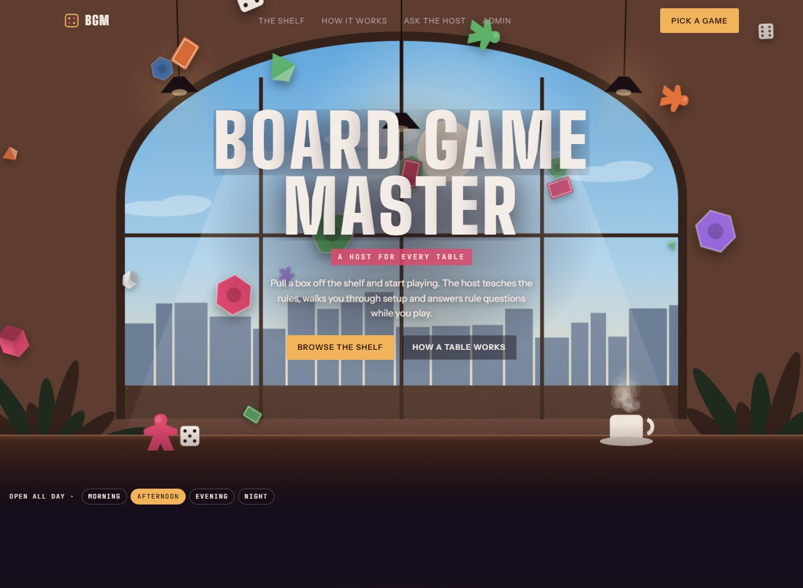
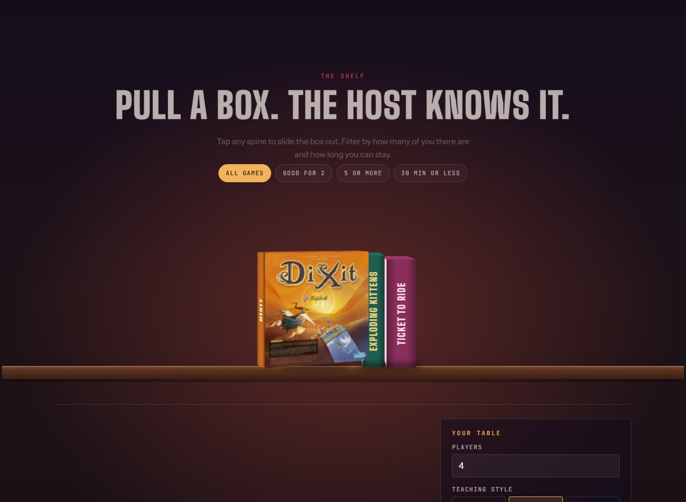
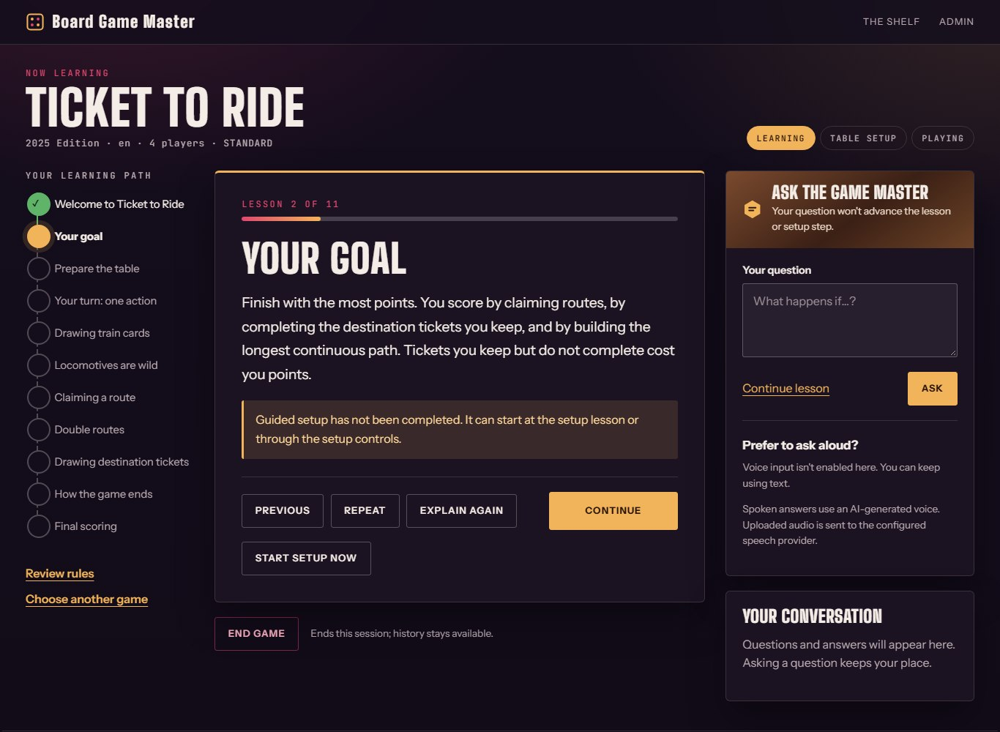
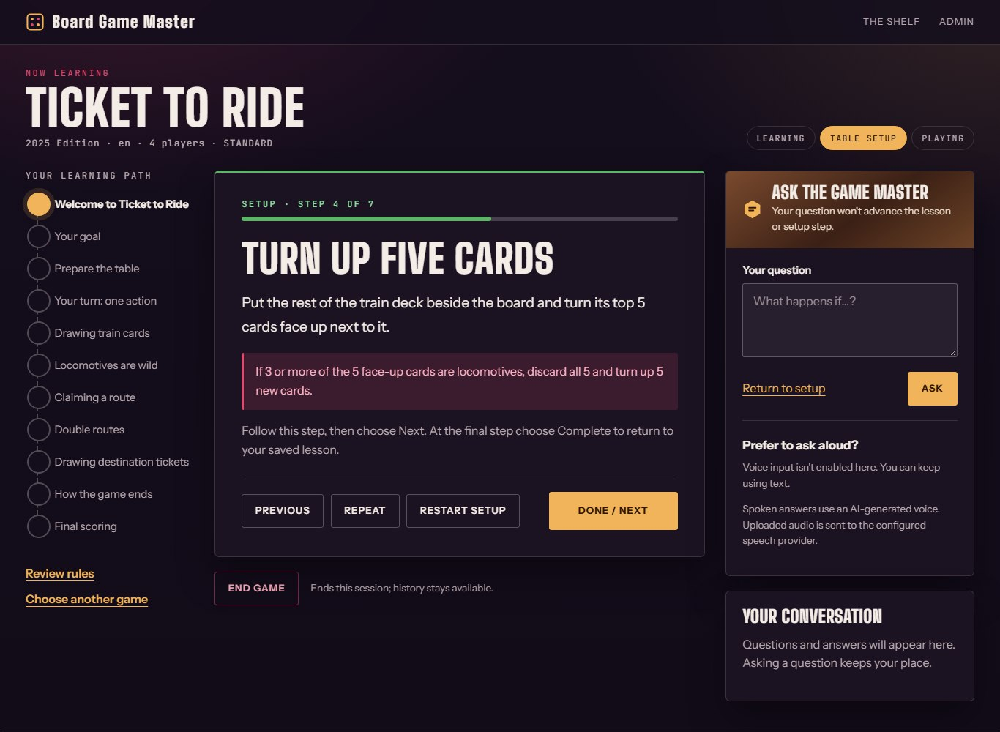
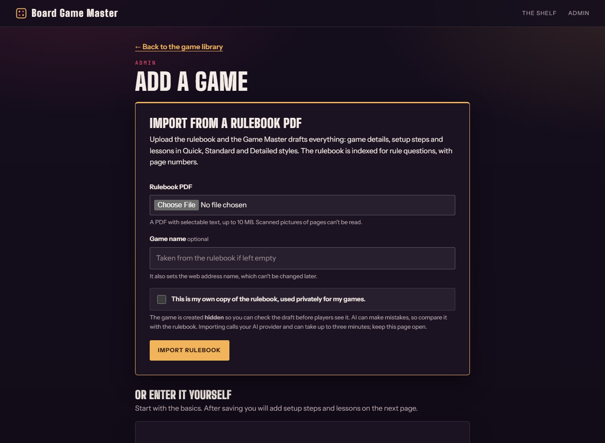
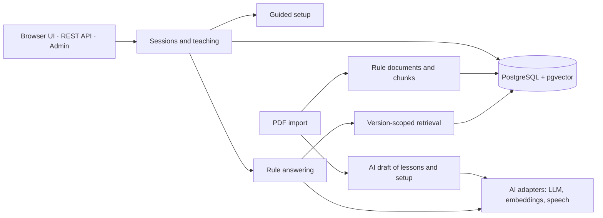

# Board Game Master

[](https://github.com/nataliachs/board-game-master/actions/workflows/ci.yml)

**An AI game master for board game night.** It teaches a game step by step, walks the table
through physical setup, and answers rule questions during play, citing the rulebook passage
and page behind every answer. A group can go from an unopened box to playing without anyone
reading the manual first.

Built with Java 21 and Spring Boot on PostgreSQL + pgvector, with retrieval-augmented generation
(RAG) for rule answers, deployed on Google Cloud Run.



[What it does](#what-it-does) · [Engineering highlights](#engineering-highlights) ·
[Architecture](#architecture) · [Run it locally](#run-it-locally) · [Tests](#tests) ·
[Documentation](#documentation)

## What it does

- **Starts at the shelf.** The home page is a café scene with a shelf of game boxes: pull one out,
  filter by group size or time, and ask the host a rule question about it straight away.
- **Teaches first.** Pick a game, the number of players and a teaching style (Quick, Standard or
  Detailed), then learn it in short lessons with a visible learning path.
- **Guides the real table.** At the right moment, the lessons hand over to step-by-step setup
  instructions with warnings for common mistakes, then return to the exact lesson you left.
- **Answers rule questions with sources.** Ask at any point without losing your place. Answers
  come from the game's own rules, each with a quoted passage and page number; when the rules
  don't support an answer, the Game Master says so instead of guessing.
- **Imports a new game from a rulebook PDF.** Upload the PDF and the app drafts the game's
  details, setup steps and lessons in all three teaching styles, and indexes the rulebook for
  questions. The game stays hidden until an admin has reviewed it.
- **Speaks, if you want.** Optional voice questions (speech-to-text) and spoken lessons and
  answers (text-to-speech).
- **Runs as a real service.** A password-protected admin area for managing games, caps on paid AI
  requests, and a container deployment on Cloud Run with Cloud SQL and Secret Manager.

| Game shelf | Lesson |
| --- | --- |
|  |  |
| **Guided setup** | **Import from a PDF** |
|  |  |

Ticket to Ride is the built-in reference game, with original lessons and setup steps written
for this project. Lessons and setup work without any AI provider; cited answers, PDF import and
voice need an OpenAI key.

## Engineering highlights

**The backend owns the workflow, not the LLM.** Teaching and setup are persisted state machines
(TEACHING → SETUP → PLAYING → COMPLETED) with optimistic revision checks, so a double click or a
second tab can't advance a lesson twice. The model explains rules; it never chooses the next
lesson or marks setup done. Each session pins the game version it started with, so publishing
new content can't change the rules halfway through a game.

**Answers have to prove where they came from.** Questions run through a version-scoped RAG
pipeline: query embedding, pgvector cosine search filtered to that game's ruleset,
deduplication and reranking, then a grounded answer under a strict JSON schema. Every quote the
model cites is matched back to the stored rulebook text, allowing only whitespace,
typographic-punctuation and Markdown-emphasis differences. If evidence is missing, weak or misquoted, the user gets an
explicit low-confidence fallback. Each fallback reason is logged, which is how a real bug
(two-column PDFs being read straight across the page) was traced and fixed.

**AI drafts are reviewed data, not live output.** The PDF import extracts text page by page with
Apache PDFBox, asks the model for one structured draft, then fits it to the app's rules (styles
nest Quick ⊂ Standard ⊂ Detailed, exactly one lesson starts setup, all lengths are bounded) and
saves it in one transaction through the same validation as hand-entered content. The rulebook
text is treated as data in the prompt, never as instructions.

**Provider-neutral AI.** Embeddings, answers, drafting, speech-to-text and text-to-speech sit
behind small interfaces in their own module; the OpenAI adapters use bounded responses, explicit
timeouts and safe error mapping. Everything works with providers switched off, and no test makes
a paid call.

**Built to be exposed to the internet.**
- HTTP Basic auth for admin pages and content-changing APIs, matching paths the way Spring
  routes them. A security review of the first version found a `/admin;x` bypass, now closed and
  covered by tests.
- Per-client and per-day caps on requests that reach paid AI providers.
- A strict Content Security Policy with no inline scripts, cross-site POST rejection, and
  `no-store` pages.
- Friendly HTML error pages for browsers and JSON errors for API clients.

**Database changes are safe to upgrade.** Nine Flyway migrations, with tests that upgrade older
databases and check that existing sessions, history and other games survive. Teaching and setup
content is published append-only, so past sessions keep the exact content they used.

## Architecture

A modular monolith: feature packages (`game`, `rules`, `rag`, `session`, `setup`, `voice`,
`ai`, `ui`) deployed as one Spring Boot application. The Thymeleaf UI and the REST API call the
same application services, so there is no duplicated business logic in the browser.



Rule answering: question → resolve the session's ruleset → embed → filtered vector search →
rerank → grounded answer under a JSON schema → validate every quote → answer with sources, or
an explicit fallback.

More in [ARCHITECTURE.md](docs/ARCHITECTURE.md).

## Tech stack

| Area | Technology |
| --- | --- |
| Backend | Java 21, Spring Boot 3.5 (Web, Data JPA, Validation, Actuator) |
| Data | PostgreSQL 17, pgvector, Flyway |
| AI | OpenAI Responses API with structured outputs (`gpt-4.1-mini` by default), `text-embedding-3-small`, Whisper and text-to-speech |
| Documents | Apache PDFBox 3 |
| Front end | Thymeleaf, hand-written CSS, small vanilla JavaScript modules |
| Testing | JUnit 5, Mockito, Testcontainers (pgvector), Spring Boot Test |
| Delivery | Docker (multi-stage, non-root), GitHub Actions, Google Cloud Run, Cloud SQL, Secret Manager, Cloud Build |

## Run it locally

You need JDK 21 and Docker Desktop. This runs lessons and setup with every AI provider off, so
it needs no API key and makes no paid calls. In PowerShell, from the repository root:

```powershell
if (-not (Test-Path .env)) { Copy-Item .env.example .env }   # then set POSTGRES_PASSWORD in .env
docker compose up -d --wait
$env:EMBEDDING_PROVIDER='disabled'; $env:LLM_PROVIDER='disabled'; $env:STT_PROVIDER='disabled'; $env:TTS_PROVIDER='disabled'
.\gradlew.bat bootRun
```

On macOS or Linux:

```sh
test -f .env || cp .env.example .env   # then set POSTGRES_PASSWORD in .env
docker compose up -d --wait
EMBEDDING_PROVIDER=disabled LLM_PROVIDER=disabled STT_PROVIDER=disabled TTS_PROVIDER=disabled ./gradlew bootRun
```

Open [localhost:8080](http://localhost:8080/), choose **Ticket to Ride**, and start a game. The
admin area is at [localhost:8080/admin](http://localhost:8080/admin) and the API documentation
at [localhost:8080/swagger-ui/index.html](http://localhost:8080/swagger-ui/index.html).

To try cited answers, PDF import or voice, add an OpenAI key and the provider settings to
`.env`; every option is described in [REFERENCE.md](docs/REFERENCE.md#configuration). To deploy
your own copy, follow [DEPLOY_GCP.md](docs/DEPLOY_GCP.md).

## Tests

```powershell
.\gradlew.bat test             # 429 unit tests, no Docker needed
.\gradlew.bat integrationTest  # 110 integration tests on real PostgreSQL + pgvector (Docker)
.\gradlew.bat check bootJar    # both suites, then the executable JAR
```

Integration tests start the real HTTP server against throwaway pgvector containers: database
migrations and upgrades, complete browser journeys, PDF import, retrieval evaluation fixtures,
and security filters. AI providers are replaced with stubs and local HTTP fixtures, so the suite
is repeatable and free. That also means it doesn't measure live-model answer quality, which is
tracked separately in the development status. CI runs `check bootJar` on every pull request.

## Documentation

| Document | What's in it |
| --- | --- |
| [Admin guide](docs/ADMIN_GUIDE.md) | Adding games by hand or from a rulebook PDF, editing, rules sources |
| [Deploying to Google Cloud](docs/DEPLOY_GCP.md) | Cloud Run, Cloud SQL, Secret Manager, costs and AI request limits |
| [Architecture](docs/ARCHITECTURE.md) | Domain model, RAG pipeline, sessions, setup and voice design |
| [Reference](docs/REFERENCE.md) | All configuration settings and REST APIs, with examples |
| [UI guide](docs/UI_GUIDE.md) | Screen priorities and visual rules for the browser journey |
| [Development status](docs/DEVELOPMENT_STATUS.md) | Dated change log, test results, live tests and known limitations |
| [Project specification](PROJECT_SPEC.md) | The original product and engineering requirements |
| [Agent instructions](AGENTS.md) | Working rules for the AI coding assistant used on this project |
| [Demo recording guide](docs/DEMO.md) | A two-minute walkthrough script |

## How it was built

I wrote the product specification first, then built the project in nine milestones: catalog,
rule ingestion, vector search, cited answers, retrieval quality, sessions and teaching, guided
setup, then voice and the browser UI. Deployment, the admin area and PDF import came after. I
developed it with an AI coding assistant working under the rules in [AGENTS.md](AGENTS.md):
read the spec first, keep workflow state in the backend, and back every change with tests. Each
step, including failed live tests and their fixes, is recorded in the
[development status](docs/DEVELOPMENT_STATUS.md).

## Known limitations

- Answer quality has been checked by hand on small question sets, not with a broad benchmark.
- Scanned PDFs (pictures of pages) aren't read; there is no OCR.
- The AI request caps are counted in memory, so they assume a single running instance.
- Games can be hidden but not deleted; rules sources can be removed.

## Rules and trademarks

Game names belong to their publishers; this is a non-commercial portfolio project. No commercial
rulebook is stored in this repository. The built-in Ticket to Ride lessons, the rules summaries
in [`docs/rules/`](docs/rules/) and the [Lantern Trail](examples/original-demo-rules.md) sample
game (CC0) are original text written for this project.
