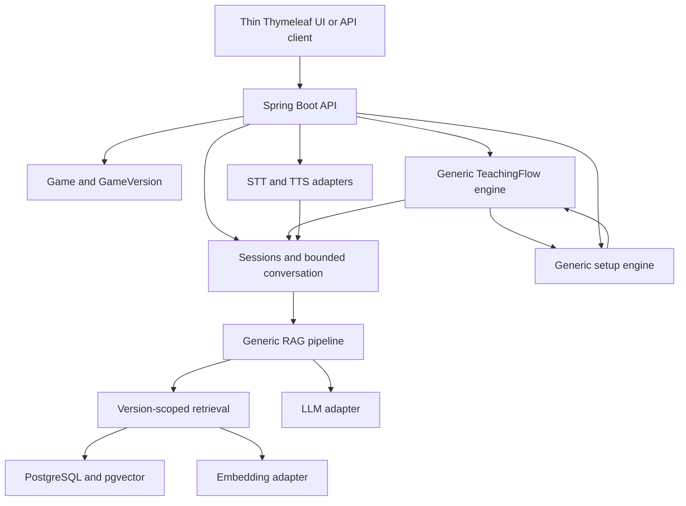

# Board Game Master

Board Game Master is an AI-powered assistant for board game cafés. Its goal is to teach customers how to play a selected game, guide physical setup, and stay available during gameplay for rule questions.

The platform is designed to support multiple board games. Catan is used as the initial reference implementation and test dataset.

## Current state

**Milestones 0–3 are complete and validated.**
The application supports generic Game and GameVersion metadata, registration/read APIs,
default-version selection, and player-count validation. Catan has one seeded reference
version (5th Edition / English). Permitted UTF-8 text/Markdown documents can now be imported
for a specific version and read as ordered, traceable chunks. Explicit embedding indexing and
version-scoped vector retrieval are implemented with opt-in provider configuration.
Milestone 4 remains unstarted; generated rules answers, sessions, TeachingFlow, setup, voice
and browser UI remain planned.

- [Master specification](PROJECT_SPEC.md)
- [Agent instructions](AGENTS.md)
- [Development status](docs/DEVELOPMENT_STATUS.md)
- [Architecture and profiles](docs/ARCHITECTURE.md)

## Planned product experience

The sections below describe the intended product, not functionality already available in the
Milestone 3 application. Current executable setup, API and test instructions are retained below.

## Customer Experience

The intended customer journey is:

1. Select a board game.
2. Select the number of players.
3. Choose how detailed the explanation should be.
4. Start a Game Master session.
5. Learn the game objective.
6. Learn the important components.
7. Follow guided physical setup.
8. Learn the core rules.
9. Learn how turns work.
10. Ask clarification questions at any point.
11. Begin playing.
12. Ask the Game Master rule questions whenever needed.

The product is designed to feel like:

> A Game Master that teaches you the game and then stays with you while you play.

It is not intended to function primarily as an open-ended chatbot.

## Teaching Experience

Teaching is progressive rather than delivered as one large explanation.

The planned backend will track TeachingFlow state so customers can:

- continue
- go back
- repeat an explanation
- ask a clarification question
- resume learning afterward

Questions will be answered using Retrieval-Augmented Generation (RAG) against verified game-rule documents.

## Guided Setup

Setup is integrated into the teaching experience.

The planned backend will track setup state independently from the LLM.

This allows customers to be guided step-by-step through physically preparing the game before gameplay begins.

## During the Game

Once teaching finishes, the same GameSession transitions into gameplay mode.

The Game Master remains available for questions such as:

- "What can I do on my turn?"
- "Can I trade now?"
- "What happens when I roll a seven?"
- "How many cards do I discard?"

Answers are grounded in the configured GameVersion's rule documents and provide source references when available.

## Architecture

The project uses a modular Spring Boot backend.

Core concepts include:

- Game
- GameVersion
- RuleDocument
- RuleChunk
- GameSession
- ConversationMessage
- TeachingFlow
- TeachingSection
- SetupFlow
- SetupStep

AI integrations are kept behind provider abstractions.

The project uses PostgreSQL with pgvector installed. Rule-document storage and semantic
retrieval are implemented; answer generation and the session/teaching/setup concepts above remain planned.

## RAG

Rule questions follow a Retrieval-Augmented Generation pipeline:

Customer Question

→

Load GameSession

→

Resolve GameVersion

→

Create Query Embedding

→

Retrieve Relevant RuleChunks

→

Rank Evidence

→

Provide Evidence to LLM

→

Generate Grounded Answer

→

Return Answer + Sources

The system should prefer saying it cannot confidently verify a rule rather than inventing one.

## Teaching depth and session stages (planned)

Choose QUICK, STANDARD or DETAILED; STANDARD is the default café experience. These are
explanation depths within the same Game Master session. The normal journey is:

Select Game → Player Count → Teaching Depth → Create Session → Teaching → Guided Setup
→ Continue Teaching → Ready to Play → In-Game Rule Q&A → Completed.

Customers normally select Game only. The backend resolves and pins an active default
GameVersion. Application-managed TEACHING / SETUP / PLAYING / COMPLETED stages and persisted
lesson/setup positions control progress; the LLM does not decide the next step. TeachingFlow
chooses what comes next; RAG supplies verified rule evidence. Clarifications preserve both
lesson and setup progress. Review Rules returns to the active game without resetting it.

## Planned architecture



Ingestion: permitted source → extraction/cleanup → semantic chunks → embeddings → version-scoped storage.
Question answering: resolve ruleset → query embedding → filtered retrieval/ranking → evidence prompt → grounded answer and citations.

## Planned stack

Java 21+, Spring Boot Web/Data JPA/Validation, PostgreSQL + pgvector, Flyway, Docker Compose, Gradle, OpenAPI, JUnit 5, Mockito, and Testcontainers. Provider abstractions cover LLM, embeddings, STT, and TTS. Phase 5 / Milestone 8 adds Thymeleaf, HTML/CSS and minimal JavaScript. UI controllers reuse backend application services; templates and JavaScript do not implement workflow, RAG or game logic.

## Local setup

Install a JDK 21 and set `JAVA_HOME` to it. A Java 21 Gradle toolchain is required;
the wrapper pins Gradle 8.14.4 and verifies its distribution SHA-256.
Install Docker Desktop with a working Linux container engine (on Windows, configure WSL 2).
The first build and container startup require internet access for dependencies and images.

Run from this repository's root in PowerShell:

```powershell
if (-not (Test-Path .env)) { Copy-Item .env.example .env }

# Edit .env and set a nonempty POSTGRES_PASSWORD before continuing.

docker compose up -d --wait
.\gradlew.bat bootRun
```

On macOS/Linux, create `.env` from `.env.example` only if it does not already exist,
then use `sh ./gradlew bootRun`.
The default `local` profile reads `.env` automatically; no shell import is needed.
Use simple unquoted `NAME=value` entries (Java properties syntax), with no `export` or
variable interpolation in `.env`. Existing environment variables override file values.
The database binds only to `127.0.0.1`; its named volume persists across restarts.
Use `docker compose stop` to stop it while retaining data. Changing credentials in
`.env` does not change credentials in an already initialized PostgreSQL volume.

Active configuration:

| Variable | Default / purpose |
| --- | --- |
| `POSTGRES_DB` | `board_game_master`; database created on first container startup |
| `POSTGRES_USER` | `board_game_master`; local database owner |
| `POSTGRES_PASSWORD` | Required local secret; also the application's default DB password |
| `POSTGRES_PORT` | `5432`; localhost port used by Compose and the local app |
| `SERVER_PORT` | `8080`; application HTTP port |
| `DB_URL`, `DB_USERNAME`, `DB_PASSWORD` | Optional local overrides; all three required for `prod` |
| `SPRING_PROFILES_ACTIVE` | Default is `local`; set `prod` for external DB configuration |
| `RULE_CHUNK_SIZE` | `1200`; maximum chunk length, 64–16000 UTF-16 characters |
| `RULE_CHUNK_OVERLAP` | `200`; whole trailing paragraph/sentence overlap budget, 0 to size minus 1 |
| `RULE_MAX_BYTES` | `1048576` (1 MiB); import byte limit, at most 10 MiB |
| `RULE_MAX_CHUNKS` | `10000`; import chunk limit, 1–100000 |
| `EMBEDDING_PROVIDER` | `disabled`; set `openai` to enable provider requests |
| `EMBEDDING_MODEL` | `text-embedding-3-small`; selected embedding model |
| `EMBEDDING_API_KEY` | Required only when `openai` is enabled; keep private |
| `EMBEDDING_DIMENSIONS` | `1536`; vector dimensions, 1–2000 |
| `EMBEDDING_TIMEOUT` | `30s`; connect/request timeout, greater than zero and at most 120s |
| `EMBEDDING_MAX_INPUT_CHARACTERS` | `4000`; maximum chunk/query UTF-16 length, 1–16000 |
| `EMBEDDING_MAX_DOCUMENT_CHUNKS` | `1000`; synchronous indexing limit, 1–10000 |
| `RAG_TOP_K` | `5`; default retrieved match count, 1–50 |

LLM/speech, `RAG_SIMILARITY_THRESHOLD` and `RAG_CHUNK_*` settings remain reserved.
Embedding settings and `RAG_TOP_K` are active. No provider keys are needed for ingestion,
startup or automated tests; the default provider is disabled.
Active ingestion configuration uses `boardgame.rules.*` / `RULE_*`; the older `RAG_CHUNK_*`
proposals remain inactive. Invalid ingestion/embedding/retrieval limits fail startup. Add optional
overrides to your existing `.env`; do not overwrite it with the example file.
The `prod` profile does not read `.env` and disables API documentation by default.
Flyway creates the vector extension; the database migration role needs suitable privileges.

## Running database, application, and tests

With the database running, `bootRun` applies Flyway migrations before Hibernate schema
validation. V1 installs pgvector; V2 creates the catalog tables and constraints;
V3 adds Catan reference metadata; V4 adds version-scoped rule documents and chunks.
Restart an already-running application to pick up the new code and migrations.
V5 adds embedding storage and its ruleset/profile index. Existing database volumes should be
retained. No rules or embeddings are seeded automatically; existing documents stay unindexed.

```powershell
.\gradlew.bat test             # Domain validation and MVC/error tests; no Docker needed
.\gradlew.bat integrationTest  # Isolated pgvector PostgreSQL via Testcontainers; Docker required
.\gradlew.bat check bootJar    # Both suites and executable JAR; fails if Docker is unavailable
```

The integration suite runs real HTTP servers and isolated PostgreSQL/pgvector containers.
It verifies migrations (including upgrading a V1 database while preserving existing data),
catalog registration/read APIs, ownership, duplicates, inactive/missing defaults, player limits,
atomic and concurrent default changes, database constraints, health, Swagger, and OpenAPI.
It never silently skips missing Docker and does not use your local Compose database or `.env`.
No tests call paid AI services. Rule ingestion tests also cover cleanup, chunk boundaries,
overlap, UTF-8 validation, source offsets, page metadata, version isolation, atomic rollback,
upload limits, migration preservation and vector retrieval. See development status for current test totals.
HTML reports appear under `build/reports/tests/test` and `build/reports/tests/integrationTest`.

Manual demonstration after starting the application:

```powershell
Invoke-RestMethod http://localhost:8080/actuator/health
Invoke-RestMethod http://localhost:8080/v3/api-docs

# Open http://localhost:8080/swagger-ui/index.html in a browser.

```

Health should contain `"status":"UP"`. Swagger documents the catalog and rule-document operations.
The test suite passed with Docker on 2026-10-07; see development status for actual results.

## Implemented catalog API

| Method | Path | Behavior |
| --- | --- | --- |
| GET | `/api/v1/games?page=0&size=20` | Stable page DTO (`items`, `page`, `size`, `totalElements`, `totalPages`), sorted by slug; size 1–100 |
| POST | `/api/v1/games` | Register metadata; 201 and Location header |
| GET | `/api/v1/games/{gameId}` | Read metadata |
| POST | `/api/v1/games/{gameId}/versions` | Register version; 201 and Location header |
| GET | `/api/v1/games/{gameId}/versions` | Read this game's versions |
| GET | `/api/v1/games/{gameId}/versions/{versionId}` | Read a version with ownership validation |
| GET | `/api/v1/games/{gameId}/default-version?playerCount=4` | Resolve the active default; player count is optional |
| PUT | `/api/v1/games/{gameId}/default-version` | Select an active, owned version using `{"gameVersionId":"..."}` |

Metadata reads include inactive games/versions for configuration visibility. Default resolution
requires an active game, an active default, and a valid player count when supplied.
Games can be registered before their versions; missing defaults return 409 rather than picking
an arbitrary version. Registering with `defaultVersion: true` replaces the previous default
atomically. Repeating PUT with the same version is idempotent. Inactive versions cannot be defaults.
Version identity is edition + versionLabel + language within a game; edition/label comparisons
are case-insensitive and language tags are stored in lowercase. Supported tag syntax includes
`en`, `id`, and `en-US`; it is a constrained syntax, not full BCP 47 registry validation.
The catalog supplies registration/read and default selection; general edits, deletion,
and activation/deactivation APIs are not implemented in this milestone.

After restarting the application, demonstrate the seeded data in PowerShell:

```powershell
Invoke-RestMethod 'http://localhost:8080/api/v1/games'
$catanId = '00000000-0000-0000-0000-000000000001'
Invoke-RestMethod "http://localhost:8080/api/v1/games/$catanId/versions"
Invoke-RestMethod "http://localhost:8080/api/v1/games/$catanId/default-version?playerCount=4"

# playerCount=2 returns HTTP 400 with code INVALID_PLAYER_COUNT.

```

Register another game and a default version:

```powershell
$gameBody = @{
    slug = "demo-$([guid]::NewGuid().ToString('N'))"
    name = 'Demo Game'
    minPlayers = 2
    maxPlayers = 4
    estimatedDurationMinutes = 30
    active = $true
} | ConvertTo-Json
$game = Invoke-RestMethod -Method Post -Uri 'http://localhost:8080/api/v1/games' `
    -ContentType 'application/json' -Body $gameBody
$versionBody = @{
    edition = 'First Edition'
    versionLabel = 'base-game'
    language = 'en'
    active = $true
    defaultVersion = $true
} | ConvertTo-Json
Invoke-RestMethod -Method Post -Uri "http://localhost:8080/api/v1/games/$($game.id)/versions" `
    -ContentType 'application/json' -Body $versionBody
Invoke-RestMethod "http://localhost:8080/api/v1/games/$($game.id)/default-version?playerCount=2"
```

Errors retain the shared `code`, `message`, `timestamp`, and `path` fields. Invalid bodies,
player counts, and pagination return 400; unknown games or versions belonging to another
game return 404; duplicates and unavailable default configurations return 409.
Catan's 90-minute duration is a demo estimate. The selected edition is a reference configuration,
not a claim to be the latest edition or to have ingested its rules. Player counts follow
[CATAN's base-game metadata](https://www.catan.com/catan).

## Implemented rule-document API

All routes are scoped to `/api/v1/game-versions/{versionId}/documents`.

| Method | Suffix | Behavior |
| --- | --- | --- |
| POST | (none) | Multipart `metadata` JSON and `file`; returns 201, metadata and Location |
| GET | `?page=0&size=20` | Document metadata pages, ordered by import time and ID; size 1–100 |
| GET | `/{documentId}` | Source metadata, import timestamp and effective chunk settings/count |
| GET | `/{documentId}/source` | Cleaned source text for tracing chunk offsets |
| GET | `/{documentId}/chunks?page=0&size=20` | Chunks ordered by zero-based `chunkIndex`; size 1–100 |

Import only sources you own or have permission to use. Upload local `.txt` or `.md` files
encoded as UTF-8. Metadata requires `name`, `sourceType` (`RULEBOOK`, `FAQ`, `ERRATA`,
`EXPANSION`), document `version`, `language`, and `sourceReference` (a descriptive source
label, local reference, or URL retained as data). Language must match the selected GameVersion.
Inactive versions can receive documents for catalog preparation. No server paths or URLs
are fetched. Files are decoded strictly; empty/binary/malformed input fails before storage.

Cleanup removes a leading BOM, normalizes line endings to LF, removes trailing spaces,
and collapses excess blank lines. Chunking follows ATX Markdown headings (`#` through `######`)
and paragraphs, then sentence/word boundaries for oversized paragraphs. Long tokens use a
Unicode-safe hard split as a fallback. Fenced code stays text. This is structural chunking,
not an AI-based semantic parser or a full Markdown renderer; Setext headings, tables and lists
receive paragraph treatment. The limit measures UTF-16 characters, not embedding tokens.

Overlap reuses whole trailing paragraphs/sentences when they fit the configured budget;
it may be smaller than requested or zero and never crosses a section or page boundary.
Optional standalone `<!-- page: N -->` markers identify positive page numbers; otherwise
`pageNumber` is null. Page markers stay in the cleaned source but are excluded from chunks.
Sections retain the nearest heading. Chunks carry document/version IDs and exact
`startOffset`/`endOffset` into cleaned source (zero-based UTF-16, exclusive end). The GameVersion
links to the owning game and edition. Imports store all chunks in one transaction.

For a safe manual demo, first register a **Demo Game** and English version using the catalog
example above, then resolve that game's default version. Do not attach fictional demo rules
to the Catan reference version. From the repository root in PowerShell:

```powershell

# $game is the Demo Game created in the catalog example above.

$version = Invoke-RestMethod "http://localhost:8080/api/v1/games/$($game.id)/default-version"
$base = "http://localhost:8080/api/v1/game-versions/$($version.id)/documents"

# curl.exe is used explicitly to avoid the Windows PowerShell curl alias.

$importJson = curl.exe --fail-with-body --silent --show-error -X POST $base `
    -F 'metadata=@examples/original-demo-metadata.json;type=application/json' `
    -F 'file=@examples/original-demo-rules.md;type=text/markdown'
$document = $importJson | ConvertFrom-Json
Invoke-RestMethod "$base/$($document.id)"
(Invoke-RestMethod "$base/$($document.id)/chunks?size=100").items | Format-List
Invoke-RestMethod "$base/$($document.id)/source"
```

The bundled Lantern Trail document is original fictional text dedicated under CC0 1.0.
It is not a commercial rulebook. For your own permitted source, use your file path after `@`
and prepare matching JSON metadata. Keep commercial/private inputs outside Git (for example
the ignored `local-rules/` folder). Swagger also accepts the multipart upload.

Errors use the shared DTO: invalid input 400, unknown/wrong-version documents 404,
unsupported extension 415, byte/chunk limits 413, database conflicts 409. A separate servlet
limit rejects files/requests over 10 MiB; oversized requests may return `PAYLOAD_TOO_LARGE`
before application-level `DOCUMENT_TOO_LARGE` validation. Upload MIME labels are not trusted;
extension and decoded contents determine acceptance.

PDF extraction, URL import, document editing/deletion, deduplication and asynchronous ingestion
are not implemented. Repeating an import creates a new document.
There is no authentication yet; this remains a local-development API. Restart the app to
apply the pending migrations before using these endpoints. The implementation checks did not migrate your local DB.

## Implemented embeddings and retrieval API

| Method | Path | Behavior |
| --- | --- | --- |
| GET | `/api/v1/game-versions/{versionId}/documents/{documentId}/embeddings` | Counts for the active vector profile; no provider call |
| POST | `/api/v1/game-versions/{versionId}/documents/{documentId}/embeddings` | Generate/store missing vectors for this document; synchronous and idempotent for the profile |
| POST | `/api/v1/game-versions/{versionId}/rules/search` | Retrieve ranked source chunks; JSON `{"query":"...","topK":5}`; topK optional |

These endpoints retrieve evidence only. They do not produce a generated answer, confidence label,
teaching flow or session. Search returns source metadata and `cosineSimilarity` (−1 to 1), which
measures vector alignment rather than confidence or factual correctness. No threshold is applied.
Unknown/wrong-version sources return 404, invalid input 400, an indexing size limit 413 and
storage conflicts 409. Disabled/unavailable/rate-limited providers return safe 503 errors,
provider timeouts 504 and invalid responses 502. Rule text and raw provider errors are not logged.

Indexing is separate from import. Restart the app to apply V5, then explicitly index each existing
document you want searchable. The provider is **disabled by default**. To opt in, add or update
these entries in your existing private `.env` without replacing its database credentials:

```dotenv
EMBEDDING_PROVIDER=openai
EMBEDDING_MODEL=text-embedding-3-small
EMBEDDING_API_KEY=your-private-api-key
EMBEDDING_DIMENSIONS=1536
```

Restart after changing configuration. Blank legacy provider/model/dimensions entries use the
disabled/default settings, so an older `.env` keeps startup working. Enabling OpenAI requires a
nonblank API key. Indexing and nonempty-index search send rule/query text to the configured
provider and may incur charges; no external provider calls were made during implementation checks.

The adapter follows the [official OpenAI embeddings API](https://developers.openai.com/api/reference/resources/embeddings/methods/create),
using float output and explicit dimensions. Select a model supporting the dimensions parameter.
The character limit is a resource bound, not an exact token count; provider token limits still
apply, and oversized chunks may need smaller ingestion settings and a fresh import.

For the demo document created in the previous section, after opting in and restarting:

```powershell
# Reuse $version.id and $document.id from the import demo, or replace with saved UUIDs.
$versionBase = "http://localhost:8080/api/v1/game-versions/$($version.id)"
$indexUrl = "$versionBase/documents/$($document.id)/embeddings"
Invoke-RestMethod $indexUrl
Invoke-RestMethod -Method Post -Uri $indexUrl
Invoke-RestMethod $indexUrl
$search = @{ query = 'What happens when my token reaches the last space?'; topK = 3 } | ConvertTo-Json
(Invoke-RestMethod -Method Post -Uri "$versionBase/rules/search" `
    -ContentType 'application/json' -Body $search).matches | Format-List
```

Expected: indexed counts equal total chunks, and search returns only this selected version's
sources, ranked by exact cosine similarity with stable tie ordering. An empty index returns an
empty match list without a query embedding call. Repeated indexing reuses existing profile vectors.
Changing provider/model/dimensions selects a different vector space; old vectors remain stored,
but each document must be indexed for the new profile before it contributes search results.
Concurrent indexing may duplicate provider requests, though stored vectors remain unique.
Indexing is atomic per document and defaults to at most 1000 chunks; large/background jobs and
model-vector deletion remain deferred. Prefer indexing permitted sources you are willing to send
to the selected provider.

Storage uses pgvector with a version/profile B-tree filter index and exact search, avoiding ANN
recall loss at current scale. See [pgvector's exact search documentation](https://github.com/pgvector/pgvector/tree/v0.8.2#querying).
Tests use fixed known vectors and local fake HTTP responses, independent of LLMs and API keys.

## Planned API examples

These are design examples, not implemented endpoints:
```http
POST /api/v1/sessions
Content-Type: application/json

{"gameId":"<game-id>","playerCount":4,"teachingDepth":"STANDARD"}
```
```http
POST /api/v1/sessions/<session-id>/messages
Content-Type: application/json

{"message":"What happens if I roll a seven?"}
```

## Development Roadmap

- [x] Milestone 0 — Project Bootstrap
- [x] Milestone 1 — Game + GameVersion Domain
- [x] Milestone 2 — Rule Documents + Ingestion
- [x] Milestone 3 — Embeddings + Vector Search
- [ ] Milestone 4 — RAG Question Answering
- [ ] Milestone 5 — Production-Quality RAG
- [ ] Milestone 6 — Game Sessions + Teaching Flow
- [ ] Milestone 7 — Guided Setup Integrated with Teaching
- [ ] Milestone 8 — Voice + Minimal Demo UI

Phase 1 = Milestones 1–4 after bootstrap; Phase 2 = Milestone 5; Phase 3 = Milestone 6;
Phase 4 = Milestone 7; Phase 5 = Milestone 8. Milestone 4 is unstarted.

## Adding a game

Register Game and GameVersion, import permitted rules, generate embeddings, configure version-bound TeachingFlow/TeachingSection and SetupFlow/SetupStep data, add retrieval evaluation cases, and activate the supported version. Shared engines should require no redesign.

## Demo UI

By the end of Phase 5, the application should provide a lightweight browser interface allowing a user to:

- choose a game
- choose player count
- choose teaching depth
- learn the game
- progress through setup
- ask questions while learning
- transition into gameplay
- ask rule questions
- view citations
- use voice input
- hear spoken answers
- review previously taught rules

The Phase 5 interface is intended for testing and portfolio demonstration rather than being the final production café UI.
Planned implementation is a lightweight Spring Boot/Thymeleaf UI with HTML/CSS/minimal
JavaScript, not a separate frontend project. It will load games from the backend, default
to STANDARD depth, preserve lesson/setup progress during Q&A, and continue the same session
into PLAYING. It will show conversation history, citations, transcription and audio, support
review and end-session actions, and display understandable errors. Text remains independently
usable. The complete Phase 5 demo must work without Swagger or Postman; the current application
still uses the documented APIs/Swagger and does not yet include this UI.

## Deferred work

Robot hardware, computer vision, café inventory, recommendations, board-state validation, analytics, and always-listening voice are outside Phases 1–5. Do not redistribute commercial rulebooks without permission.
